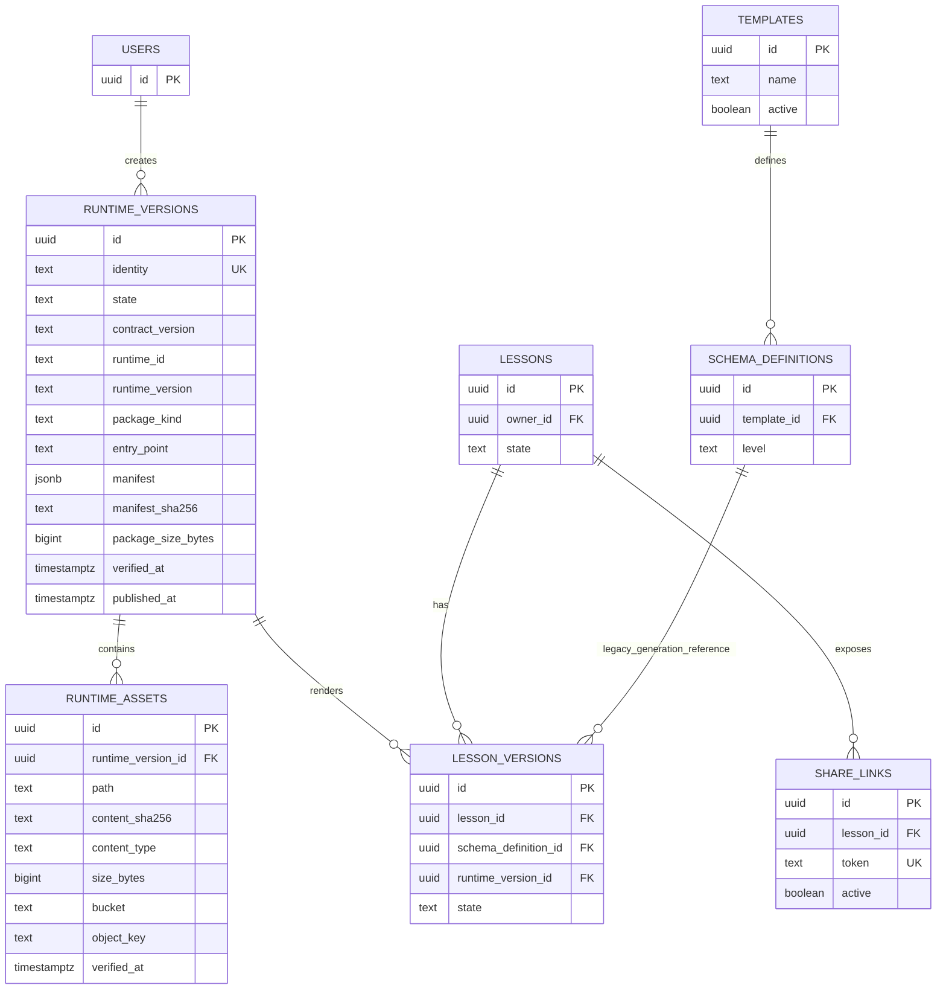

# Fusaha — Persistent Runtime Storage ADR

- **Status:** Proposed — architecture investigation only
- **Date:** 2026-10-31
- **Scope:** Immutable shared Runtime packages and their assets
- **Branch reviewed:** `feat/hide-authenticated-start-cta`
- **Decision owners:** Fusaha platform maintainers
- **Implementation status:** Not implemented

> This ADR changes no application behavior and does not create tables, buckets, migrations, environment variables, or storage objects.

## 1. Executive decision

Use **PostgreSQL metadata plus a private Supabase Storage bucket in the existing Supabase project**, with content-addressed immutable object keys and a database publication state machine.

PostgreSQL remains the source of truth for:

- Runtime identity and immutable manifest metadata.
- Asset metadata, hashes, sizes, and object keys.
- Publication state and verification timestamps.
- Lesson-Version to Runtime-Version references.
- Reference counts/eligibility for collection.

Supabase Storage holds the package files and binary assets. It is selected because Fusaha already uses Supabase Auth and a Supabase/PostgreSQL database, while the repository has no existing object-storage abstraction or provider integration to preserve. This is a recommendation to provision and verify a private bucket later; it is **not evidence that Storage is currently connected or configured**.

The design deliberately avoids treating an in-memory registry as persistent identity. A Runtime becomes visible only after every object is uploaded, every hash is verified, and one database transaction publishes a complete `runtime_versions` record. A failed or partial upload remains invisible and recoverable.

## 2. Verified current state

### 2.1 Database and ORM

Verified from:

- `package.json`
- `lib/db/index.ts`
- `database/schema/index.ts`
- `database/schema/*.ts`

The application uses PostgreSQL through `postgres` and Drizzle ORM. `lib/db/index.ts` creates a lazy `postgres(DATABASE_URL, { prepare: false })` client and exports a Drizzle schema-backed proxy. The active schema is exported from `database/schema/index.ts`.

The active schema contains users, authorization, lessons, lesson versions, share links, templates, schema definitions, generation events, billing, and audit domains. It does not contain `runtime_versions`, `runtime_assets`, or a Runtime foreign key on `lesson_versions`.

### 2.2 Existing file/storage mechanisms

Repository inspection found:

- No `@vercel/blob`, S3 client, storage adapter, upload service, signed-URL helper, or object-storage module.
- No storage/upload/asset/blob/S3 implementation files.
- `database/schema/templates.ts` stores `previewImage` as text and explicitly documents that it is a Data URI because no blob/S3 storage exists yet.
- `RuntimePackage` currently stores files as an in-memory `Record<string, string>`.

Therefore, the architecture must not claim that an existing storage provider is available.

### 2.3 Existing Runtime contracts

Verified from `lib/runtime/`:

- `types.ts` defines `RuntimeManifest`, `RuntimePackage`, package kinds, capabilities, entry point, and asset integrity metadata.
- `manifest.ts` canonicalizes manifest fields and validates entry point/assets.
- `hash.ts` calculates a SHA-256 identity from canonical manifest plus sorted file paths and file contents.
- `registry.ts` provides an in-memory registry with `putIfAbsent`, integrity checks, and defensive copies.
- `lesson-version-binding.ts` provides an in-memory immutable binding service.
- `persistent-store.ts` defines a persistence boundary and lifecycle contract, but has no database or object-storage implementation.
- `adapters/html-player.ts` is the current HTML player adapter.

These are useful contracts to preserve. They are not production persistence.

### 2.4 Current generation and rendering

Verified from:

- `actions/generation.ts`
- `src/trigger/generate-lesson.ts`
- `lib/dashboard/queries/lesson.ts`
- `lib/dashboard/queries/share-link.ts`
- `lib/templates/compose-player-html.ts`
- `app/dashboard/lessons/[id]/run/frame/route.ts`
- `app/l/[token]/frame/route.ts`

Generation reads the selected Schema Definition and Template, sends their blueprint/validation/player inputs to Trigger.dev, and creates/updates lesson versions. No Runtime identity is recorded.

Dashboard and public-share rendering resolve the current approved lesson through Schema Definition and Template joins and compose `templates.htmlPlayer` with lesson content. Existing lessons are therefore still dependent on the mutable Template/Schema lifecycle.

### 2.5 Authentication and authorization

Verified from `lib/auth/dal.ts` and `lib/supabase/`:

- Supabase Auth establishes the user identity.
- Local `users`, `roles`, `permissions`, and `rolePermissions` records provide application authorization.
- Teacher and admin boundaries are enforced through the auth DAL and protected layouts/actions.
- `lib/supabase/admin.ts` creates a service-role client and must never be used in browser code.
- Public share routes are token-based and do not represent authenticated user ownership by themselves.

Live RLS policies, grants, deployed configuration, and Storage policies are **unverified** from source alone.

## 3. Requirements and invariants

The persistent design must preserve these invariants:

1. A published Runtime Version is immutable.
2. Identical package content produces one deterministic Runtime identity.
3. Multiple users, lessons, and versions may reference one Runtime.
4. Every migrated Lesson Version eventually references exactly one Runtime Version.
5. Identity includes all execution-relevant package inputs.
6. Metadata and file bytes have separate responsibilities.
7. Template and Schema edits/deletion do not mutate published Runtime behavior.
8. Historical lessons remain playable from their Runtime after Template/Schema changes.
9. Single-file and multi-file packages are supported.
10. A future runtime technology can use the same persistence layer through the existing adapter contract.
11. Incomplete packages are never published or returned by normal retrieval.
12. Referenced packages/assets are never collected.
13. Retries are idempotent and concurrent identical registration cannot create duplicate identities.
14. Storage immutability is separate from browser/runtime execution safety; both require controls.

## 4. Alternatives comparison

Weights are architectural judgment, not measured production benchmarks. Pricing and service limits require external verification before implementation.

| Criterion | Weight | A. PostgreSQL only | B. Existing platform object storage | C. Supabase Storage + PostgreSQL | D. Independent S3-compatible storage + PostgreSQL |
|---|---:|---:|---:|---:|---:|
| Immutability/publication control | 20% | 4/5 | 4/5 | 4/5 | 5/5 |
| Content-addressed deduplication | 15% | 5/5 | 4/5 | 4/5 | 5/5 |
| Reliability/durability | 15% | 3/5 | 3/5 | 4/5 | 5/5 |
| Security/access control | 15% | 4/5 | 3/5 | 4/5 | 5/5 |
| Multi-file/scalable packages | 10% | 2/5 | 4/5 | 4/5 | 5/5 |
| Operational simplicity for Fusaha | 10% | 3/5 | 3/5 | 5/5 | 2/5 |
| Backup/recovery and portability | 10% | 3/5 | 3/5 | 3/5 | 5/5 |
| Local testing and stack compatibility | 5% | 5/5 | 3/5 | 4/5 | 3/5 |
| **Weighted result** | **100%** | **3.55** | **3.50** | **4.05** | **4.45** |

### A. Database-only

**Rejected as the default.** It has simple transactional metadata and strong uniqueness constraints, but large HTML bundles/assets inflate database backups and queries. It also makes multi-file growth and serving assets less appropriate. It remains acceptable for very small packages or a local test adapter, not the production package store.

### B. Database plus an existing platform object store

**Not currently available.** Source inspection found no existing Fusaha object-storage provider or abstraction. This option cannot be selected based on assumption. If a platform bucket is later provisioned and satisfies private access, immutable keys, lifecycle, and recovery requirements, it becomes operationally similar to option C.

### C. Supabase Storage plus PostgreSQL

**Recommended.** It keeps the existing Supabase operational boundary, avoids introducing a second provider, supports private objects and signed/controlled delivery, and separates bytes from relational metadata. It still requires explicit bucket/policy provisioning and a recovery plan. Object storage and PostgreSQL are not one atomic transaction, so the publication protocol below is mandatory.

### D. Independent S3-compatible storage plus PostgreSQL

**Technically strongest portability/durability option, but not the first choice.** It is attractive if package volume, cross-region recovery, compliance, or multi-cloud portability justifies another provider. It adds credentials, lifecycle configuration, monitoring, egress/cost decisions, local emulation, and operational ownership that Fusaha does not currently have.

## 5. Logical data architecture

The minimum production model is three relational entities plus object storage:

1. `runtime_versions` — immutable package identity and publication metadata.
2. `runtime_assets` — one row per package file/object.
3. `lesson_versions.runtime_version_id` — the binding from a lesson version to one published Runtime.

A separate publication table is **not required initially**. Publication state, verification timestamps, and failure metadata can live on `runtime_versions`. Add a separate append-only publication-attempt table only if operational audit volume or retry forensics justifies it.

### 5.1 `runtime_versions`

**Purpose:** canonical immutable Runtime package record and publication state.

Recommended fields:

- `id uuid primary key default gen_random_uuid()` — internal relational identity.
- `identity text not null` — `sha256-<64 lowercase hex>` content identity.
- `contract_version text not null` — current Runtime contract version.
- `runtime_id text not null` — adapter/runtime family.
- `runtime_version text not null` — runtime family version.
- `package_kind text not null` — `single-file` or `multi-file`.
- `entry_point text not null` — canonical package entry path.
- `manifest jsonb not null` — canonical manifest snapshot used at publication.
- `manifest_sha256 text not null` — hash of canonical manifest.
- `package_size_bytes bigint not null` — total verified bytes.
- `state text not null` — `pending`, `published`, `failed`, `deletion_pending`, `collected`.
- `created_by uuid null` — creator/audit identity if applicable; not package ownership.
- `created_at timestamptz not null`.
- `verified_at timestamptz null`.
- `published_at timestamptz null`.
- `failed_at timestamptz null`.
- `failure_code text null` — sanitized operational code, never a secret.
- `last_accessed_at timestamptz null` — optional operational signal.

Constraints and indexes:

- `unique(identity)` is the primary deduplication gate.
- Check state transitions in service code and, where practical, a database check constraint.
- `identity` must match the canonical identity format.
- `published_at` is non-null only for `published`/later retained states.
- Index `(state, created_at)` for reconciliation.
- Index `(last_accessed_at)` only if retention policy uses access age.
- Do not expose mutable manifest update operations after publication.

Deletion behavior:

- No physical delete while referenced by `lesson_versions`.
- Logical collection only after reference count is zero, retention grace period elapsed, and an explicit reconciler approval exists.
- `published` must not transition directly to physical deletion.

### 5.2 `runtime_assets`

**Purpose:** verified mapping from a Runtime package file path to a private storage object.

Recommended fields:

- `id uuid primary key`.
- `runtime_version_id uuid not null references runtime_versions(id) on delete restrict`.
- `path text not null` — normalized relative POSIX path; no `..`, leading `/`, or backslash.
- `content_sha256 text not null` — hash of exact bytes.
- `content_type text not null` — allowlisted MIME type.
- `size_bytes bigint not null`.
- `storage_provider text not null` — initially `supabase-storage`.
- `bucket text not null` — private bucket identifier.
- `object_key text not null` — content-addressed immutable key.
- `verified_at timestamptz not null`.
- `created_at timestamptz not null`.

Constraints and indexes:

- `unique(runtime_version_id, path)`.
- `unique(storage_provider, bucket, object_key)`.
- Check `size_bytes >= 0` and hash format.
- Index `(content_sha256)` for diagnostics/dedup analysis.
- Do not use user-provided path as an unrestricted storage key.

Object key recommendation:

```text
runtime-assets/sha256/<asset-sha256>/<normalized-safe-filename>
```

The Runtime package identity remains the package-level hash. The object key is independently content-addressed so an identical asset can be reused safely in future packages, while the relational row preserves package membership and path.

### 5.3 `lesson_versions.runtime_version_id`

Recommended field:

- `runtime_version_id uuid null references runtime_versions(id) on delete restrict` during migration.

Lifecycle:

1. Nullable during backfill.
2. New approved versions require it after the generation cutover.
3. Existing ambiguous/unrecoverable versions remain explicitly quarantined or receive an approved legacy-runtime record; never guess silently.
4. After backfill validation, enforce `not null` for the supported lesson-version states.
5. Keep `schema_definition_id` during the compatibility period for generation/editing/audit, but rendering must resolve the immutable Runtime once bound.

Indexes:

- Index `lesson_versions(runtime_version_id)`.
- Unique is not appropriate: many lesson versions may share one Runtime.

Deletion behavior:

- `on delete restrict` prevents collecting a referenced Runtime.
- Deleting a Lesson may cascade its Lesson Versions according to existing policy; the Runtime remains if other references exist and becomes eligible only after all references are gone.

## 6. Entity relationship diagram



`SCHEMA_DEFINITIONS` and `TEMPLATES` remain generation/editing dependencies during transition. They must not be the source of truth for Runtime playback after binding.

## 7. Package identity and hashing

### 7.1 Canonical package input

Keep the existing `lib/runtime/manifest.ts` and `lib/runtime/hash.ts` boundary, but make the persisted algorithm explicit:

1. Validate the package before hashing.
2. Normalize every path to a relative POSIX path.
3. Reject duplicate paths, traversal, absolute paths, NUL bytes, and ambiguous Unicode normalization.
4. Sort manifest assets by normalized `path`.
5. Sort capabilities lexicographically and remove duplicates.
6. Sort metadata keys.
7. Serialize canonical manifest with deterministic JSON rules and no insignificant whitespace.
8. Hash the canonical manifest bytes.
9. Hash each file's exact bytes, not a decoded/re-encoded string representation.
10. Sort files by normalized path.
11. Hash a framed sequence containing path length, path bytes, content length, and content bytes to avoid concatenation ambiguity.
12. Produce `sha256-<64 lowercase hex>` as the Runtime identity.

The current `hash.ts` hashes canonical manifest plus sorted path/content strings. That is a good contract baseline, but the persistent implementation should use explicit byte framing and exact bytes for binary/multi-file support. This is a **necessary contract hardening decision**, not a reason to rewrite the Runtime subsystem.

Conceptual framing:

```text
H(
  "runtime-package/v1\0" +
  uint64(canonical_manifest_length) + canonical_manifest_bytes +
  for each sorted file:
    uint64(path_length) + path_bytes +
    uint64(content_length) + content_bytes
)
```

Store the algorithm/version in the manifest or contract version. Changing canonicalization must create a new contract version; never silently reinterpret an old identity.

### 7.2 Concurrent deduplication

Use PostgreSQL `unique(identity)` as the authoritative race gate:

1. Validate and hash outside the transaction.
2. Upload objects to deterministic temporary keys.
3. Verify all objects.
4. `INSERT ... ON CONFLICT (identity) DO NOTHING` for the package record.
5. If another transaction won, load the existing published/pending record and compare manifest hash/asset metadata.
6. Never overwrite an existing identity.
7. If the existing record is `pending`, reconcile it under a lease or wait/retry; do not publish a second record.
8. Return the existing complete Runtime only after `state = published`.

A SHA-256 collision must not silently merge different manifests. On conflict, compare canonical manifest bytes, manifest hash, asset count, paths, sizes, and content hashes. If any differ for the same identity, fail with an integrity/collision alert and quarantine both attempts; do not overwrite.

## 8. Storage lifecycle and publication protocol

PostgreSQL and Supabase Storage cannot normally share one atomic transaction. Use a staged protocol with database state as visibility control.

### 8.1 Create and validate

1. Adapter creates a `RuntimePackage`.
2. Validate manifest, paths, capabilities, MIME types, entry point, and limits.
3. Canonicalize manifest and calculate package identity.
4. Calculate every asset hash and size.
5. Check the persistent store for an already published identity.
6. If found, verify the requested manifest matches and reuse it.

### 8.2 Upload to an invisible staging namespace

1. Create an idempotency key for the registration attempt.
2. Insert a `pending` runtime row or registration record with an expiration/lease.
3. Upload every object under a non-published temporary prefix such as:

```text
staging/<attempt-id>/<asset-sha256>
```

4. Use private bucket access and immutable content-addressed destination names.
5. Never expose staging keys through a resolver.
6. Upload manifest metadata only after package validation.

### 8.3 Verify and publish

1. Read each uploaded object metadata/body as required by the provider API.
2. Recompute hash and size from stored bytes.
3. Verify content type and normalized path mapping.
4. Insert all `runtime_assets` rows in one transaction.
5. Move/copy objects to deterministic immutable final keys if staging keys are not already content-addressed final keys.
6. Verify final object existence and metadata.
7. In one database transaction:
   - lock the pending runtime row;
   - confirm every expected asset row exists and is verified;
   - set `state = published`, `verified_at`, and `published_at`;
   - make the record visible to resolvers.
8. Only after commit, clean temporary aliases if needed.

The resolver must query `state = published` only. A pending or failed row is never playable.

### 8.4 Reuse

A second lesson registration calculates the same identity, hits the unique constraint, verifies compatibility, and references the existing published Runtime. It does not copy package bytes or mutate the Runtime.

### 8.5 Retrieval

1. Load the Runtime by `lesson_versions.runtime_version_id`.
2. Require `state = published`.
3. Load the manifest/assets and verify expected metadata.
4. Generate controlled asset URLs or proxy bytes through a server route.
5. Optionally verify object metadata/hash on cache miss or via a background integrity reconciler.
6. If an object is missing/corrupt, fail closed with an operational error; never fall back to the current Template silently.

### 8.6 Cleanup

A reconciler may collect only when:

- No Lesson Version references the Runtime.
- No active publication/registration lease exists.
- Retention grace period has elapsed.
- The object list matches the database record.
- An explicit collection operation records the decision.

Delete relational metadata only after object deletion is confirmed, or retain a tombstone/audit record. Never collect based only on an in-memory reference count.

## 9. Failure and recovery strategy

| Failure | Required behavior |
|---|---|
| Validation failure | No upload; return structured validation error |
| One object upload fails | Mark attempt failed/expired; delete or quarantine staging objects; remain invisible |
| DB failure after upload | Objects remain under staging/deterministic orphan prefix; reconciler retries registration or cleans after grace period |
| DB publish failure | Runtime remains pending; resolver cannot see it; retry with lease/idempotency key |
| Process crash | Reconciler finds expired pending records and staged objects; resumes or cleans safely |
| Concurrent identical registration | PostgreSQL unique identity decides winner; loser reuses verified winner |
| Concurrent different package with same identity | Compare manifest/asset metadata; integrity alert; no overwrite |
| Missing final object | Retrieval fails closed; mark integrity issue; do not use Template fallback |
| Corrupt object | Hash mismatch; quarantine Runtime or fail retrieval; alert and repair from verified source/backup |
| Provider timeout | Retry with bounded exponential backoff and idempotent object keys |
| Duplicate retry | Same attempt/idempotency key and content identity; no duplicate published record |

A periodic reconciliation job should report:

- pending records past lease;
- published records with missing assets;
- objects without metadata rows;
- metadata rows without objects;
- hash/size mismatches;
- unreferenced packages past retention.

## 10. Security architecture

### 10.1 Storage defaults

Objects should be **private by default**. A public lesson share token must not become an unrestricted bucket path or permanent public object permission.

Recommended access model:

- Server-side resolver authorizes the lesson/share request.
- Server route returns the composed player or issues short-lived signed URLs for only the exact published assets required.
- Signed URL lifetime is short and scoped to the object path.
- Do not expose service-role keys or storage management credentials to browsers.
- Do not use client-controlled object keys.

### 10.2 Upload validation

Before publication:

- allowlist package kind, MIME types, extensions, and total/package/asset size limits;
- reject path traversal, absolute paths, backslashes, NUL bytes, duplicate paths, and dangerous names;
- validate manifest/entry point/capabilities with `validateRuntimePackage`;
- compute hashes from bytes;
- reject unexpected external imports if the runtime policy disallows them;
- scan or sanitize HTML/JS according to the execution policy.

### 10.3 Playback and execution

Immutable bytes do not make HTML/JavaScript safe. Runtime execution must be isolated:

- iframe with an appropriate sandbox policy;
- strict `Content-Security-Policy` appropriate to the runtime capabilities;
- explicit `postMessage` origin validation;
- no arbitrary network access unless declared and approved;
- no access to authenticated parent cookies or privileged APIs;
- controlled handling of `lesson-data` injection;
- safe response MIME types and `nosniff` headers.

The existing HTML-player adapter is a contract boundary, not a complete security sandbox.

### 10.4 Authorization boundaries

- Upload/publish: authenticated teacher/admin operation with ownership/permission checks.
- Runtime reuse: package identity may be shared; ownership of the Runtime is not a substitute for lesson authorization.
- Authenticated playback: lesson ownership/access policy before resolving the Runtime.
- Public share: valid active share token, active lesson state, and exact lesson-bound Runtime only.
- Storage admin operations: server-only service role, never browser.

## 11. Integration contract

### `lib/runtime/persistent-store.ts`

Preserve the existing interface direction, but evolve the boolean result into a typed result that can distinguish:

- `created`;
- `reused`;
- `pending`;
- `conflict`;
- `integrity-failure`;
- `unavailable`.

Required operations:

```text
registerOrReuse(package, idempotencyKey) -> published Runtime reference
getPublished(identity) -> immutable Runtime package metadata
getPublishedForLessonVersion(lessonVersionId) -> immutable Runtime reference
bindLessonVersion(lessonVersionId, runtimeVersionId) -> idempotent binding
verify(runtimeVersionId) -> integrity result
markFailed/expirePending(attemptId) -> lifecycle result
collect(runtimeVersionId) -> only when unreferenced and approved
```

The persistent implementation must use Drizzle transactions for relational state and a storage adapter for objects. The contract must never expose a mutable `updateRuntime` operation.

### Generation workflow

After generated content is validated:

1. Build the Runtime package through the adapter.
2. Register-or-reuse the package.
3. Bind the new Lesson Version to the returned published Runtime in the same relational transaction as the lesson-version approval transition.
4. Emit a generation event containing Runtime identity.
5. If binding/publication fails, do not mark the Lesson Version ready.

The Trigger.dev task must remain retry-safe: same lesson-version/idempotency identity should reuse the same Runtime, not create copies.

### Dashboard rendering

Add a resolver that starts from `lesson_versions.runtime_version_id`, requires `published`, and returns the Runtime manifest/assets. It must not join back to the mutable Template for playback. Keep the existing Template/Schema query path only for editing/generation during migration.

### Public sharing

`getApprovedLessonByShareToken` must resolve the lesson version and then its Runtime binding. The share token authorizes access to that lesson; it does not authorize arbitrary package-object access. Public routes should use the same immutable Runtime resolver as dashboard playback.

### Existing adapters

Keep `RuntimeAdapter`, `RuntimePackage`, manifest validation, and adapter-specific rendering. Add a storage-independent package repository beneath them. Future runtime technologies implement adapters; they do not redesign relational storage.

## 12. Testing and reliability strategy

### Unit tests

- Canonical manifest order and metadata order.
- Path normalization and traversal rejection.
- Exact identity determinism for reordered input.
- Different content/path/config produces different identity.
- Binary bytes hash without text transcoding.
- Asset hash/size/content-type validation.
- Immutable registry semantics retained.
- No mutable Runtime update API.

### Database integration tests

Run against an isolated PostgreSQL/Supabase test database:

- unique identity constraint;
- concurrent `registerOrReuse` race;
- asset unique `(runtime_version_id, path)`;
- restrict deletion for referenced Runtime;
- nullable-to-non-null binding migration;
- idempotent binding;
- transaction rollback on incomplete asset metadata;
- lesson-version delete and Runtime retention behavior.

### Storage integration tests

Against a disposable private bucket or emulator where supported:

- private object defaults;
- upload/retry/idempotency;
- object hash/size verification;
- missing/corrupt object detection;
- staging cleanup;
- final-key collision behavior;
- signed URL expiry and exact object scope;
- process restart retrieval.

### End-to-end tests

- New generation publishes/reuses Runtime and binds Lesson Version.
- Dashboard playback uses bound Runtime.
- Public share uses bound Runtime.
- Template update does not change old approved playback.
- Schema update/deletion does not change old approved playback.
- Deleting a referenced Runtime is rejected.
- Multiple users/lessons reuse one Runtime.
- Historical versions render after source lifecycle changes.
- Unsupported future package kind fails closed and does not publish.

### Recovery tests

- Crash after each upload step.
- Crash after object finalization before DB commit.
- Crash after DB publish before cleanup.
- Reconciler repairs/cleans each state.
- Retry after timeout does not duplicate metadata or objects.

## 13. Cost and operational considerations

No repository evidence can verify current Supabase Storage pricing, quotas, regional durability, egress charges, retention features, or signed URL limits. Those require external verification before provisioning.

Operational requirements:

- private bucket policy and service-role boundary;
- storage usage and egress monitoring;
- orphan/reconciliation metrics;
- hash mismatch alerts;
- database and object-storage backup/recovery procedure;
- retention/grace-period policy;
- local test adapter or disposable test bucket;
- documented provider export/restore procedure.

The recommendation prioritizes operational simplicity and existing platform alignment, not an unverified pricing claim. If package volume, compliance, recovery objectives, or cross-region requirements exceed Supabase Storage capabilities, revisit independent S3-compatible storage without changing the relational contract.

## 14. Migration implications

No migration should be created until Phase 0 evidence is approved.

Required sequence:

1. Inventory lessons, versions, Templates, Schemas, active shares, and current rendered outputs in isolated Staging.
2. Capture golden fixtures for representative dashboard/public-share cases.
3. Decide how ambiguous historical versions are quarantined or assigned an explicitly approved legacy Runtime.
4. Add `runtime_versions` and `runtime_assets` tables.
5. Add nullable `lesson_versions.runtime_version_id` with `on delete restrict`.
6. Implement package registration/reconciliation without changing playback.
7. Backfill only deterministic/recoverable versions.
8. Verify counts, hashes, bindings, and rendering fixtures.
9. Switch new generation to register-and-bind.
10. Switch dashboard/public playback to Runtime resolver behind an explicit rollout gate.
11. Monitor and compare golden outputs.
12. Enforce non-null for supported lesson-version states only after acceptance.
13. Keep legacy fallback/quarantine explicit; never silently resolve to current Template.

Rollback must preserve the old columns and rendering path until Runtime playback has passed acceptance. A rollback must not delete published Runtime records or detach successful bindings.

## 15. Implementation sequence

### Phase 0 — evidence gate

- Verify isolated Staging identity read-only.
- Inventory current entities and relationships.
- Produce golden rendering fixtures.
- Approve recovery and ambiguous-history policy.

### Phase 1 — persistence foundation

- Add schema migrations and constraints.
- Implement storage adapter interface and private-bucket configuration.
- Implement canonical byte hashing and package validation hardening.
- Implement pending/published states and reconciliation.

### Phase 2 — registration and reuse

- Implement `PersistentRuntimePackageStore`.
- Add atomic identity registration, idempotency, and concurrency tests.
- Add asset verification and private retrieval.

### Phase 3 — generation binding

- Register/reuse Runtime after generation validation.
- Bind `lesson_versions.runtime_version_id` transactionally.
- Add generation event identity and retry tests.

### Phase 4 — playback cutover

- Resolve dashboard and public share from the bound Runtime.
- Preserve explicit legacy fallback only during migration.
- Compare golden rendering output.

### Phase 5 — lifecycle and security

- Decouple Template/Schema updates from published playback.
- Enforce reference-protected collection.
- Add CSP/sandbox/signed delivery controls.

### Phase 6 — backfill and enforcement

- Backfill deterministic historical versions.
- Quarantine ambiguous/unrecoverable versions.
- Enforce non-null binding after evidence and rollback gates.

## 16. Risks and unresolved decisions

1. **Storage provisioning:** Supabase Storage is recommended but not verified/provisioned in this repository.
2. **Object/database transaction gap:** publication protocol and reconciler are mandatory; operational ownership must be assigned.
3. **Hash contract evolution:** current string-based hashing must be versioned before binary/multi-file persistence; changing it would create new identities.
4. **Historical ambiguity:** current mutable Template/Schema rows may not reproduce old outputs; inventory must classify this before backfill.
5. **Runtime execution security:** HTML/JS isolation and CSP require product/security approval separate from storage design.
6. **Public delivery:** choose signed URLs versus server proxy based on package size, caching, and token leakage analysis.
7. **Cross-user reuse authorization:** Runtime bytes may be shared by identity, but lesson access must remain lesson-scoped.
8. **Retention policy:** grace period, backup retention, and legal/audit requirements are unresolved.
9. **Large-package limits:** maximum package/file sizes and provider limits require external verification.
10. **Legacy fallback duration:** must have an explicit sunset and monitoring, not become a permanent hidden dependency.

## 17. Unverified assumptions

The following are deliberately not asserted as facts:

- Supabase Storage is enabled for the project.
- The project has a suitable private bucket.
- Storage policies/RLS allow the proposed server access.
- Current production/staging schema, grants, RLS, migrations, or rows match repository source.
- Supabase Storage pricing, quotas, durability, regions, or egress limits.
- A provider supports every desired atomicity/lifecycle operation exactly as described.
- Existing public share tokens should grant access to every Runtime asset without additional policy.

These must be verified before implementation or provisioning.

## 18. Final decision and gate

**Decision:** adopt PostgreSQL metadata plus private Supabase Storage, content-addressed immutable objects, database publication state, and reference-protected collection. Preserve the Runtime contracts and adapters; implement persistence behind `lib/runtime/persistent-store.ts`.

**Current status:** architecture only. No application behavior, database state, storage bucket, environment variable, deployment, or Runtime behavior was changed.

**Implementation gate:** do not create migrations or provision storage until Phase 0 read-only inventory, golden fixtures, isolated identity verification, and recovery policy are approved.
