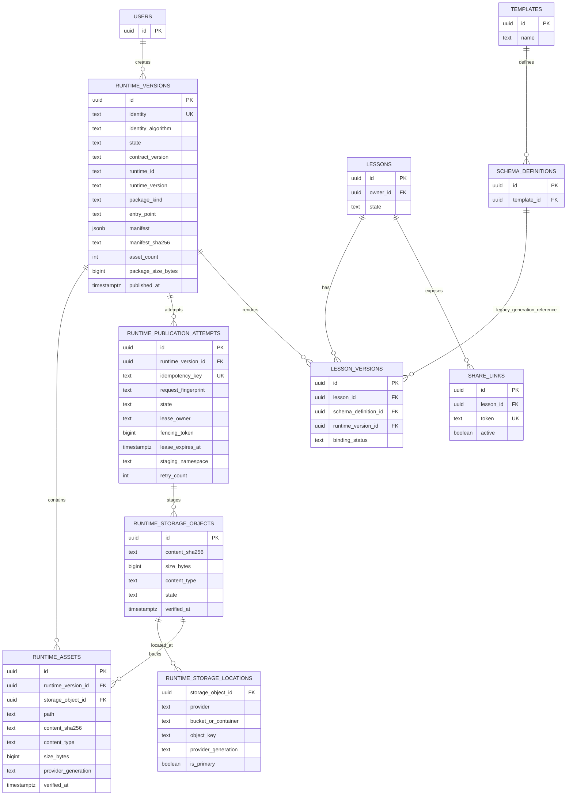

# Fusaha — Persistent Runtime Storage ADR

- **Status:** Proposed — not approved for production implementation
- **Contract revision:** v2
- **Date:** 2026-10-31
- **Scope:** Immutable shared Runtime packages, assets, publication, and Lesson-Version bindings
- **Branch reviewed:** `feat/hide-authenticated-start-cta`
- **Implementation status:** Documentation only

> This document changes no application behavior. It creates no tables, migrations, buckets, objects, environment variables, or deployments.

## 1. Decision summary

Use PostgreSQL metadata plus a private Supabase Storage bucket **only as the current provider recommendation**, behind a provider-neutral object-storage adapter. The design is not approved until an isolated proof of concept proves the publication protocol, byte identity, write-once behavior, crash recovery, and multi-file delivery.

PostgreSQL is the source of truth for Runtime identity, immutable manifest metadata, publication state, asset metadata, and Lesson-Version bindings. Object storage holds bytes only. A Runtime is visible to playback only after all objects are verified and a database transaction publishes a complete record.

Supabase Storage is recommended over independent S3-compatible storage because Fusaha already uses Supabase Auth/PostgreSQL and has no existing object-storage abstraction. The weighted table gives S3-compatible storage a higher raw score for portability/durability, so this is a **conditional operational recommendation**, not a claim that Supabase is technically superior. Choose S3 instead if verified RPO/RTO, region, compliance, package volume, or provider portability requirements outweigh the lower operational complexity of staying within Supabase.

**Current verdict:** not production-ready. **POC gate:** the design is ready for an isolated technical POC only after the open assumptions in Section 17 are accepted as POC inputs and the POC uses disposable resources.

## 2. Verified facts from the repository

### 2.1 Database and authentication

Verified from `package.json`, `lib/db/index.ts`, `database/schema/index.ts`, `lib/auth/dal.ts`, and `lib/supabase/`:

- The application uses PostgreSQL through `postgres` and Drizzle ORM.
- `lib/db/index.ts` constructs a lazy `postgres(DATABASE_URL, { prepare: false })` client.
- Supabase Auth establishes identity; local roles/permissions provide application authorization.
- `lib/supabase/admin.ts` creates a service-role client and must remain server-only.
- The repository schema has no `runtime_versions`, `runtime_assets`, `runtime_publication_attempts`, or Runtime foreign key on `lesson_versions`.
- Live database schema, RLS, grants, deployed migrations, and Storage policies are unverified.

### 2.2 Existing storage

Repository inspection found no `@vercel/blob`, S3 client, upload service, signed-URL helper, or object-storage adapter. `database/schema/templates.ts` stores `previewImage` as text/Data URI because blob/S3 storage is not currently present.

Therefore, “Supabase Storage” below is a proposed provider, not an existing capability.

### 2.3 Existing Runtime boundary

Verified from `lib/runtime/`:

- `types.ts` currently defines `RuntimePackage.files` as `Record<string, string>`.
- `manifest.ts` validates/canonicalizes Runtime manifests.
- `hash.ts` currently computes a SHA-256 identity from canonical manifest plus sorted string paths/content.
- `registry.ts` and `lesson-version-binding.ts` are in-memory services.
- `persistent-store.ts` is a persistence boundary without a database/object-storage implementation.
- `adapters/html-player.ts` is the current adapter.

These contracts must not be silently broken by this ADR. Binary support requires an explicitly versioned contract extension or an explicit UTF-8-only scope.

### 2.4 Existing generation and playback

Verified from `actions/generation.ts`, `src/trigger/generate-lesson.ts`, dashboard/share queries, `compose-player-html.ts`, and the dashboard/public frame routes:

- Generation reads Template and Schema Definition data and does not record Runtime identity.
- Dashboard and public-share playback currently resolve Template/Schema joins and compose `templates.htmlPlayer` with lesson content.
- Existing playback is still mutable-source dependent until the Runtime resolver cutover.

## 3. Requirements and corrected invariants

1. A published Runtime Version and its published asset metadata are immutable.
2. Identical canonical package bytes produce one deterministic identity per identity algorithm version.
3. Multiple Lesson Versions may reference one Runtime.
4. Every **playable approved** Lesson Version has exactly one published Runtime binding after cutover.
5. Historical versions may be `quarantined`, `legacy`, or `unrecoverable` during migration and are not counted as playable until explicitly recovered.
6. Template/Schema edits or deletion never mutate published Runtime playback after binding.
7. Incomplete, failed, or quarantined packages are never returned by normal playback resolution.
8. Retries and concurrent identical registrations are idempotent.
9. Storage identity is separate from physical bucket/provider location.
10. A future Runtime adapter uses the same persistence/publication contract.
11. Referenced Runtime records/assets are never collected.
12. Storage immutability and browser/runtime execution safety are separate controls.
13. Public share authorization is lesson-scoped; a share token cannot select arbitrary Runtime objects.
14. A provider outage cannot cause fallback to the current mutable Template for a version already bound to a Runtime.

## 4. Provider comparison and decision rule

Weights are architectural judgment, not measured benchmarks. Pricing, quotas, durability, region, and egress require provider verification.

| Criterion | Weight | PostgreSQL only | Existing platform store | Supabase Storage + PG | Independent S3 + PG |
|---|---:|---:|---:|---:|---:|
| Write-once/publication control | 20% | 4 | 4 | 4 | 5 |
| Content-addressed deduplication | 15% | 5 | 4 | 4 | 5 |
| Reliability/durability | 15% | 3 | 3 | 4 | 5 |
| Security/access control | 15% | 4 | 3 | 4 | 5 |
| Multi-file scalability | 10% | 2 | 4 | 4 | 5 |
| Fusaha operational simplicity | 10% | 3 | 3 | 5 | 2 |
| Backup/recovery portability | 10% | 3 | 3 | 3 | 5 |
| Local testing/stack fit | 5% | 5 | 3 | 4 | 3 |
| **Weighted result** | **100%** | **3.55** | **3.50** | **4.05** | **4.45** |

### Decision rule

- Select **Supabase Storage** for the first POC and likely first implementation if it passes the required write-once, private delivery, recovery, and package-serving tests and the product accepts its verified operational limits.
- Select **independent S3-compatible storage** instead if any required RPO/RTO, region, compliance, provider lock-in, object-versioning, or scale requirement fails for Supabase.
- Do not select “existing platform object storage”: no such Fusaha abstraction/provider was verified.
- PostgreSQL-only remains a test adapter or small-package fallback, not the production default.

The recommendation is therefore based on current stack fit and operational simplicity, while the weighted matrix explicitly records that S3 has the stronger technical portability/durability score.

## 5. Corrected relational data model

The production model has four relational entities, not three:

1. `runtime_versions` — immutable package identity and lifecycle.
2. `runtime_assets` — logical package files and verified physical-object references.
3. `runtime_publication_attempts` — durable idempotency, leases, staging, retries, and crash recovery.
4. `lesson_versions.runtime_version_id` — immutable playback binding.

### 5.1 `runtime_versions`

Recommended fields:

- `id uuid primary key`.
- `identity text not null` — `sha256-v1-<64 lowercase hex>`.
- `identity_algorithm text not null` — e.g. `runtime-package/v1`.
- `contract_version text not null`.
- `runtime_id text not null`.
- `runtime_version text not null`.
- `package_kind text not null` — `single-file` or `multi-file`.
- `entry_point text not null`.
- `manifest jsonb not null` — canonical manifest snapshot.
- `manifest_sha256 text not null`.
- `asset_count integer not null`.
- `package_size_bytes bigint not null`.
- `state text not null` — `pending`, `published`, `failed`, `quarantined`, `deletion_pending`, `collected`.
- `created_by uuid null`.
- `created_at`, `verified_at`, `published_at`, `failed_at`, `last_accessed_at`.
- `failure_code text null` — sanitized, never secret.
- `integrity_issue text null` — sanitized operational code.

Constraints:

- `unique(identity_algorithm, identity)`.
- `asset_count >= 1`, `package_size_bytes >= 0`.
- `published_at` required for `published` and retained published states.
- Published manifest/identity/package fields cannot be updated. Lifecycle fields may change only through the state machine.
- `on delete restrict` from `runtime_assets` and `lesson_versions`.

### 5.2 `runtime_assets`

This table separates logical asset identity from physical storage location.

Recommended fields:

- `id uuid primary key`.
- `runtime_version_id uuid not null references runtime_versions(id) on delete restrict`.
- `path text not null` — normalized relative POSIX path.
- `content_sha256 text not null`.
- `size_bytes bigint not null`.
- `content_type text not null` — allowlisted MIME type.
- `storage_object_id uuid not null` — provider-neutral immutable object identity.
- `provider_generation text null` — ETag/version/generation equivalent captured at verification.
- `verified_at timestamptz not null`.
- `created_at timestamptz not null`.

Constraints:

- `unique(runtime_version_id, path)`.
- `unique(storage_object_id)` only if the adapter maps one immutable object to one logical object record; otherwise use a separate object table.
- `size_bytes >= 0` and hash format checks.
- No user-controlled path is used directly as a provider key.

### 5.3 Provider-neutral `runtime_storage_objects`

To support provider migration without changing Runtime identity or lesson bindings, use a provider-neutral object record:

- `id uuid primary key` — stable logical object ID.
- `content_sha256 text not null`.
- `size_bytes bigint not null`.
- `content_type text not null`.
- `state text not null` — `staged`, `available`, `missing`, `quarantined`, `deleted`.
- `created_at`, `verified_at`, `last_verified_at`.

A provider location is adapter-owned and may be represented by a separate `runtime_storage_locations` table:

- `storage_object_id uuid references runtime_storage_objects(id) on delete restrict`.
- `provider text` — `supabase-storage` or `s3-compatible`.
- `bucket_or_container text`.
- `object_key text`.
- `provider_generation text`.
- `is_primary boolean`.
- `created_at`, `verified_at`.

The logical object ID, asset path, asset hash, Runtime identity, and Lesson-Version binding do not change when a provider location is copied and verified. A new provider location becomes primary only after hash/size/content-type verification.

### 5.4 `runtime_publication_attempts`

This table is mandatory for durable idempotency and crash recovery.

Recommended fields:

- `id uuid primary key` — attempt ID.
- `runtime_version_id uuid null references runtime_versions(id) on delete restrict`.
- `identity_algorithm text not null`.
- `runtime_identity text not null`.
- `idempotency_key text not null`.
- `request_fingerprint text not null` — canonical manifest/package fingerprint.
- `state text not null` — `created`, `leased`, `uploading`, `verifying`, `finalizing`, `published`, `failed`, `expired`, `quarantined`.
- `lease_owner text null`.
- `fencing_token bigint not null`.
- `lease_expires_at timestamptz null`.
- `staging_namespace text not null` — opaque attempt-owned prefix.
- `expected_asset_count integer not null`.
- `expected_package_size_bytes bigint not null`.
- `retry_count integer not null default 0`.
- `last_error_code text null`.
- `last_error_at timestamptz null`.
- `created_at`, `updated_at`, `completed_at`.

Constraints/indexes:

- `unique(idempotency_key)` for the caller’s retry identity.
- `unique(identity_algorithm, runtime_identity, request_fingerprint)` for equivalent package attempts.
- At most one active lease per attempt through conditional updates.
- `state`, `lease_expires_at`, and `updated_at` indexes for reconciliation.
- Never store secrets, signed URLs, or raw user tokens in this table.

### 5.5 `lesson_versions.runtime_version_id`

During migration this remains nullable. After cutover:

- New approved/playable versions require a published Runtime binding.
- `on delete restrict` prevents collection while referenced.
- Multiple Lesson Versions may reference one Runtime.
- `binding_status` should distinguish `bound`, `legacy`, `quarantined`, and `unrecoverable` if historical migration requires it.
- Only `bound` approved versions are playable through the new Runtime resolver.

A quarantined/unrecoverable version is explicitly not playable; it must not be silently rendered from the current Template.

## 6. Corrected ERD



## 7. Publication state machine and fencing

### 7.1 Runtime Version states

Allowed transitions:

```text
pending -> published
pending -> failed
pending -> quarantined
published -> deletion_pending
published -> quarantined        (integrity incident only; playback fails closed)
deletion_pending -> collected (only after references=0 and object collection succeeds)

`collected` and published package identity fields are terminal. No transition creates a different package under the same identity.

### 7.2 Publication attempt states

```text
created -> leased
leased -> uploading
uploading -> verifying
uploading -> failed
verifying -> finalizing
verifying -> failed
finalizing -> published
finalizing -> failed
leased/uploading/verifying/finalizing -> expired (lease timeout)
failed/expired -> leased (bounded retry with incremented fencing token)
failed/expired -> quarantined (retry budget exhausted or integrity issue)
```

Only `published` attempts may cause the Runtime Version to become `published`.

### 7.3 Conditional updates and fencing

Every worker operation must include:

```sql
UPDATE runtime_publication_attempts
SET state = $next_state,
    lease_owner = $owner,
    lease_expires_at = $expiry,
    fencing_token = fencing_token + 1,
    updated_at = now()
WHERE id = $attempt_id
  AND state = $expected_state
  AND lease_owner = $owner
  AND fencing_token = $observed_token
  AND lease_expires_at > now()
RETURNING fencing_token;
```

A zero-row update means the worker is stale, fenced, or the state already advanced. It must stop and never write final objects or publish metadata. Reconciliation acquires a new lease and fencing token only after expiry.

The final publication transaction must lock the attempt and Runtime row, verify the current fencing token, verify every asset/object, and conditionally set `runtime_versions.state = 'published'`.

## 8. Byte-safe identity contract

### 8.1 Compatibility rule

The current `RuntimePackage.files: Record<string, string>` contract is not silently changed by this ADR. Before production persistence, choose one explicitly:

- **Contract v1 compatibility mode:** files are UTF-8 text only; binary/multipart packages are rejected.
- **Contract v2 byte mode:** add a byte-oriented package representation (`Uint8Array`/Buffer or equivalent) and version the adapter boundary. Existing text callers are converted to UTF-8 bytes at the boundary.

The POC must implement byte mode in a test-only adapter or prove the text-only restriction. It must not claim binary support while accepting lossy strings.

### 8.2 Canonical package algorithm

Identity format:

```text
sha256-v1-<64 lowercase hexadecimal characters>
```

Canonicalization algorithm `runtime-package/v1`:

1. Validate manifest and files before hashing.
2. Normalize paths to Unicode NFC, then relative POSIX paths with `/`.
3. Reject empty paths, `.`, `..`, leading `/`, `\\`, NUL, control characters, duplicate normalized paths, and ambiguous percent-encoded separators.
4. Use UTF-8 bytes for normalized paths and canonical JSON.
5. Sort paths by unsigned lexicographic byte order, not locale-dependent `localeCompare`.
6. Sort capabilities by UTF-8 bytes and reject duplicates.
7. Canonicalize manifest keys recursively in UTF-8 byte order; emit JSON without insignificant whitespace; reject unsupported values (`undefined`, NaN, Infinity).
8. Require every manifest asset to have normalized path, content hash, byte size, and allowlisted content type.
9. Verify manifest asset hash/size against the exact file bytes.
10. Hash a framed byte stream:

```text
UTF8("runtime-package/v1\0")
U64BE(manifest_byte_length)
manifest_bytes
for file in sorted_files:
  U64BE(path_byte_length)
  path_bytes
  U64BE(content_byte_length)
  content_bytes
```

11. Hash the complete stream using SHA-256 and prepend `sha256-v1-`.
12. Persist `identity_algorithm` and `manifest_sha256`; never reinterpret old identities after canonicalization changes.

This is a new versioned identity contract. Existing in-memory v0 identities must either be explicitly labeled legacy or be re-created through the v1 canonicalization; no silent equality assumption is allowed.

### 8.3 Deterministic test vectors

The POC must freeze these vectors before persistence:

| Vector | Canonical input | Expected assertion |
|---|---|---|
| V1 — single UTF-8 file | manifest `{entryPoint:"index.html", assets:[{path:"index.html", contentSha256:H("hello"), sizeBytes:5, contentType:"text/html"}]}` and bytes `hello` | identity is stable and begins `sha256-v1-`; exact 64-hex digest is recorded in the POC test fixture |
| V2 — order independence | Same files/manifest as V1, supplied in reverse object/asset order | digest equals V1 |
| V3 — path/content distinction | `a.txt = "ab"` versus `a.txt = "a"`, `b.txt = "b"` | digests differ because framed boundaries differ |
| V4 — Unicode normalization | NFC `é.txt` versus NFD `e\u0301.txt` with identical bytes | normalized canonical path produces the same digest |
| V5 — RTL/special text | Arabic content containing `<`, `&`, quotes, and literal `</script>` | bytes are hashed exactly; digest is independent of HTML escaping |
| V6 — binary | bytes `00 ff 10 80` in byte mode | digest is stable and differs from UTF-8 replacement/decoding |
| V7 — manifest change | Same bytes, changed capability/entry point/content type | digest differs |

The exact hexadecimal outputs must be generated and committed with the POC test fixture; this ADR intentionally does not invent digest values without running the selected canonicalization implementation.

## 9. Publication protocol and crash recovery

### 9.1 Registration

1. Validate the package and calculate v1 identity/fingerprint before upload.
2. Insert or load `runtime_publication_attempts` by `idempotency_key`.
3. If the same key has a different fingerprint, fail with idempotency conflict.
4. If identity is already published and metadata matches, return it without uploading.
5. Create/lease a pending Runtime and increment the fencing token.

### 9.2 Staging

Upload to a private staging namespace:

```text
runtime-staging/<attempt-id>/<fencing-token>/<content-sha256>
```

Use provider no-overwrite creation. A retry with a different fencing token must not overwrite an old object; it creates a new staged location or reuses an exact verified object.

### 9.3 Verification/finalization

1. Read provider metadata and, where necessary, bytes.
2. Verify exact hash, size, MIME type, path mapping, and expected count.
3. Create logical storage-object rows and asset rows with provider generation/version metadata.
4. Copy/create final content-addressed objects with overwrite disabled.
5. Verify final object metadata again.
6. In one DB transaction, lock the attempt and Runtime row, check fencing token and all expected assets, then set Runtime and attempt to `published`.
7. Cleanup staging objects only after publication commit; cleanup is retryable and never required for playback visibility.

### 9.4 Crash-recovery matrix

| Crash point | Durable state | Reconciler action | Visibility |
|---|---|---|---|
| Before attempt insert | Nothing | None | Invisible |
| After attempt insert, before lease | `created` | Lease or expire by TTL | Invisible |
| During staging upload | `uploading`, staged prefix | Reacquire lease; verify/reuse exact staged objects or delete/quarantine | Invisible |
| After some objects upload | Partial staged objects | Compare hashes; complete missing files or clean prefix | Invisible |
| After all staging uploads, before verify | `uploading` | Re-verify all objects | Invisible |
| During verification | `verifying` | Recompute/compare all metadata | Invisible |
| Asset rows committed, before final object copy | `verifying`/`finalizing` | Detect rows without final object; copy/verify or quarantine | Invisible |
| Final objects exist, before publish transaction | `finalizing` | Verify final objects and publish under new valid lease | Invisible |
| Publish transaction commits, before cleanup | `published` | Keep playback; cleanup staging later | Visible |
| DB transaction rolls back after final objects | `finalizing` | Reconcile final objects and retry publish or quarantine | Invisible |
| Worker lease expires while still running | Old fencing token | All later writes fail conditional update; stale worker stops | Invisible until new owner publishes |
| Published object missing/corrupt | `published` plus integrity incident | Mark `quarantined`/incident, restore from verified backup or provider replica | Fails closed |
| Cleanup fails after publication | `published` | Retry cleanup; orphan monitor alerts | Visible |

No resolver may return `pending`, `failed`, `expired`, or `quarantined` records.

## 10. Provider-neutral storage adapter

The persistence layer must depend on this logical contract, not Supabase/S3 SDK types:

```text
createImmutableObject(input:
  logicalObjectId,
  contentBytes,
  contentSha256,
  sizeBytes,
  contentType,
  writeNamespace,
  noOverwrite=true
) -> ProviderObjectRef

headObject(providerObjectRef) ->
  { sizeBytes, contentType, providerGeneration, checksum }

copyImmutableObject(sourceRef, destinationLogicalId) -> ProviderObjectRef

readObject(providerObjectRef) -> byte stream

createReadGrant(providerObjectRef, expiresAt, audience) -> short-lived grant

deleteUnpublishedObject(providerObjectRef) -> result

deletePublishedObject(providerObjectRef) -> denied unless collection token
```

`ProviderObjectRef` is an adapter-internal value containing provider, container, key, and generation. It must not be the Runtime identity or Lesson binding.

Adapter requirements:

- `noOverwrite=true` is enforced at the provider API call and checked in tests.
- A successful create returns provider generation/ETag/version, which is persisted and rechecked.
- Published-object update/delete is denied by policy and adapter code.
- Supabase and S3 implementations must expose the same logical operations.
- Provider errors map to stable categories: `not_found`, `conflict`, `timeout`, `permission_denied`, `integrity_mismatch`, `unavailable`.

### Provider migration

1. Create a new provider location for the same logical object.
2. Copy bytes from the verified primary location.
3. Verify hash, size, MIME type, and provider generation.
4. Insert the new location as non-primary.
5. Switch primary location in a transaction/conditional update.
6. Keep the old location until retention and restore verification pass.
7. Delete old location only through collection policy.

Runtime identity, asset path, logical object ID, and Lesson-Version binding remain unchanged.

## 11. Multi-file Runtime delivery architecture

### 11.1 Package URL model

A published package is served through an authenticated server route, not by exposing bucket keys:

```text
GET /runtime/v1/<runtime-id>/<asset-path>
```

The route must:

1. Resolve `<runtime-id>` to a published Runtime.
2. Normalize/reject the requested path using the same path rules as identity.
3. Confirm the path exists in `runtime_assets`.
4. Authorize the request against the parent Lesson/active share token or an internal signed grant.
5. Resolve the provider-neutral object to its current primary location.
6. Stream bytes with stored MIME type, `X-Content-Type-Options: nosniff`, immutable content hash headers, and controlled cache headers.

`runtime-id` is an opaque database/public identifier, not a bucket key. The server never accepts a client-selected provider, bucket, or object key.

### 11.2 Entry point and relative assets

For `multi-file` packages:

- `entry_point` must resolve to a stored HTML entry asset.
- The package route is the stable base for relative URLs.
- The HTML response is served from `/runtime/v1/<runtime-id>/<entry-point>` so relative `./assets/app.js` requests resolve under the same Runtime prefix.
- Path traversal, encoded separators, and cross-package paths are rejected.
- Absolute/external resources are denied unless declared in the manifest capability policy.
- No current `composePlayerHtml` call is required for multi-file delivery.

For `single-file` HTML-player packages, the existing composer remains a compatibility path during migration, but a bound Runtime must be the source of its immutable HTML/player bytes after cutover.

### 11.3 Dashboard and public-share authorization

- Dashboard route: authenticated session plus lesson ownership/permission, then bound Runtime and asset path.
- Public share route: active share token plus active lesson/share policy, then the exact Lesson-Version binding; the token cannot request another Runtime ID.
- Signed grants, if used, must contain Runtime ID, normalized asset path, audience/share scope, expiry, and a nonce; they must not contain reusable service credentials.
- Do not put long-lived unrestricted signed URLs into cacheable HTML.

### 11.4 MIME, cache, CSP, and CORS

- MIME comes from verified allowlisted metadata, never from the request.
- Immutable assets may use `Cache-Control: public, max-age=31536000, immutable` only when the URL contains the immutable Runtime identity and asset hash; authenticated/private responses should use private cache controls or a carefully scoped CDN policy.
- Entry HTML should use restrictive cache behavior when it embeds lesson-specific data or share authorization.
- CSP must be defined per Runtime capability. Default policy denies arbitrary network, plugins, frames, and inline execution except explicitly approved needs.
- CORS is denied by default. If a resource must be fetched cross-origin, allow only the exact deployment/share origin and test credentials behavior.
- The iframe sandbox and `postMessage` origin checks remain mandatory; storage immutability does not make Runtime JavaScript safe.

## 12. Security and recovery requirements

### Storage security

- Private bucket/container by default.
- Service-role/storage-management credentials server-only.
- No client-controlled provider key or path.
- No overwrite for staged or final object creation.
- Published object update/delete denied except a fenced collection operation.
- Provider generation/checksum persisted and rechecked.
- Staged prefixes expire and are reconciled.

### Runtime security

- Sandbox iframe with an approved flag set.
- CSP and external-resource capabilities are explicit manifest inputs.
- `postMessage` validates exact origin and message schema.
- Lesson data injection is escaped/serialized independently of asset bytes.
- Public share token cannot become arbitrary object access.
- Missing/corrupt object fails closed; never fall back to the mutable current Template.

### Backup and restore

Before production, define and test:

- RPO/RTO for database and objects.
- Coordinated database snapshot plus object inventory/versioned export.
- Restore order: provider configuration/policies, object bytes, metadata, then read-only hash reconciliation.
- Hash/size/MIME verification of every restored object before Runtime publication.
- Recovery when DB snapshot and object inventory are from different points in time.
- Region/provider failover decision and export format.
- Alerting for references whose objects cannot be restored.

## 13. Integration contract without silently changing Runtime contracts

`lib/runtime/persistent-store.ts` remains the boundary. No application Runtime contract is changed by this ADR.

The future implementation may add a typed result around the existing direction:

```text
registerOrReuse(package, idempotencyKey) -> created | reused | pending | conflict | integrity-failure | unavailable
getPublished(identity, algorithm) -> immutable Runtime metadata
getPublishedForLessonVersion(lessonVersionId) -> immutable Runtime reference
bindLessonVersion(lessonVersionId, runtimeVersionId) -> idempotent binding
verify(runtimeVersionId) -> integrity result
acquire/releasePublicationLease(attemptId, fencingToken) -> result
markFailed/expirePending(attemptId, fencingToken) -> result
collect(runtimeVersionId, collectionToken) -> result
```

The storage adapter is beneath this interface. Future adapters create packages; they do not know bucket keys or provider SDKs.

Generation must register/reuse before marking a new Lesson Version approved/playable. Dashboard and public share must resolve from `lesson_versions.runtime_version_id` after cutover, not from current Template/Schema joins.

## 14. Testing and POC acceptance

### Identity tests

- Exact v1 vectors V1–V7 in Section 8.3.
- Reordered maps/assets produce the same identity.
- Unicode/path normalization is deterministic.
- Binary bytes are preserved in byte mode.
- Manifest hashes/sizes match stored bytes.
- Different entry point/capability/content produces a different identity.
- Existing string contract is either rejected for binary or explicitly converted to UTF-8.

### Database tests

- Unique `(identity_algorithm, identity)` race.
- Unique idempotency key and fingerprint conflict.
- Lease acquisition/expiry/fencing race.
- State-transition checks.
- Asset/object references with `on delete restrict`.
- Idempotent Lesson-Version binding.
- Quarantined/unrecoverable historical behavior.

### Storage tests

- Private defaults.
- No-overwrite create conflict.
- Published update/delete denial.
- Provider generation/ETag persistence and mismatch detection.
- Staging cleanup and orphan detection.
- Provider migration preserving logical object/Runtime identity.
- Signed grant scope and expiry.

### Delivery tests

- Single-file entry point.
- Multi-file relative JS/CSS/image paths.
- Traversal and cross-package path rejection.
- Dashboard authorization.
- Public-share authorization and token scope.
- MIME, cache, CSP, CORS, iframe, and `postMessage` behavior.
- Missing/corrupt object fails closed.

### Crash/recovery tests

Inject process failure after every row/object/state transition in Section 9.3 and assert the matrix outcome. A POC is not accepted until every crash state converges without publishing incomplete bytes or duplicating a Runtime identity.

## 15. Historical binding and migration

Historical states are explicit:

- `bound`: approved/playable and has one published Runtime.
- `legacy`: approved/playable using an explicitly created legacy Runtime package.
- `quarantined`: historical data exists but cannot be safely reconstructed; not playable through the new resolver.
- `unrecoverable`: evidence shows no safe reconstruction; requires operator/product decision.

The invariant “every Lesson Version has a Runtime” applies only to `bound` and `legacy` playable states after cutover. It does not silently apply to quarantined/unrecoverable records.

Migration sequence:

1. Read-only Staging inventory with verified target identity.
2. Capture golden dashboard/public-share outputs.
3. Classify historical versions; never infer old identity from mutable current Template/Schema data.
4. Add nullable binding/Runtime tables only after approval.
5. Implement publication attempts, adapter, and reconciliation.
6. Backfill deterministic versions only.
7. Verify hashes, references, and golden outputs.
8. Switch new generation to register-and-bind.
9. Switch playback behind a rollout gate.
10. Enforce non-null for supported playable states only after acceptance.
11. Retain explicit legacy/quarantine behavior and rollback path.

Template/Schema rows may remain for generation/audit during transition. Their deletion/update policy must retain enough metadata for audit without affecting bound playback.

## 16. Revised implementation roadmap

### Phase 0 — contract and evidence gate

- Approve this v2 amendment’s state machine, byte contract, delivery route, adapter contract, and recovery objectives.
- Verify isolated POC database/bucket identity only; no Staging/Production access.
- Produce exact hash vectors and golden rendering fixtures.

### Phase 1 — disposable technical POC

- Implement test-only byte package adapter and provider-neutral storage adapter.
- Implement disposable `runtime_publication_attempts`/state machine model.
- Prove no-overwrite, generation metadata, fencing, crash recovery, concurrent deduplication, and multi-file delivery.
- Prove database/object backup-restore reconciliation.

### Phase 2 — production persistence design

- Convert POC findings into reviewed schema/migrations.
- Verify Supabase vs S3 decision against actual RPO/RTO, region, volume, security, and recovery requirements.
- Define policies, operational ownership, metrics, and alerts.

### Phase 3 — generation and binding

- Register/reuse Runtime after validation.
- Bind approved Lesson Versions transactionally.
- Preserve old playback path until rollout evidence passes.

### Phase 4 — playback cutover

- Resolve dashboard/public share from bound Runtime.
- Enable package route for multi-file delivery.
- Measure fallback/quarantine/missing-object errors.

### Phase 5 — backfill and enforcement

- Backfill deterministic/legacy packages.
- Quarantine ambiguous versions explicitly.
- Enforce binding requirements for supported playable states.
- Enable collection only after reference, backup, and recovery acceptance.

## 17. Remaining blockers and unverified assumptions

The following remain unverified and block production implementation:

- Supabase Storage availability, bucket policy, private access, no-overwrite behavior, object generation semantics, limits, region, pricing, egress, and recovery.
- Actual deployed DB schema, RLS, grants, migrations, and service-role boundaries.
- Whether product requirements allow UTF-8-only packages or require byte-mode Runtime contract extension.
- Exact CSP/sandbox/external-network policy for Runtime JavaScript.
- RPO/RTO, backup format, restore order, and failover provider/region.
- Historical lesson inventory and recoverability classification.
- Whether the chosen package route can safely serve public-share assets without token/cache leakage.
- Operational owner and alerting/SLO policy for reconciliation and integrity incidents.

## 18. Final status

**Architecture approval:** no. The six P0 requirements are now specified, but they are design decisions awaiting isolated technical proof.

**POC readiness:** yes, conditionally. An isolated disposable POC may begin only with synthetic fixtures and disposable PostgreSQL/object-storage resources, no Staging/Production access, and explicit test acceptance for the state machine, byte identity, write-once storage, crash matrix, provider adapter, and multi-file delivery.

**Production readiness:** no. Do not create production migrations, provision the real bucket, backfill historical data, or cut over playback until the POC passes and the remaining blockers are resolved.
