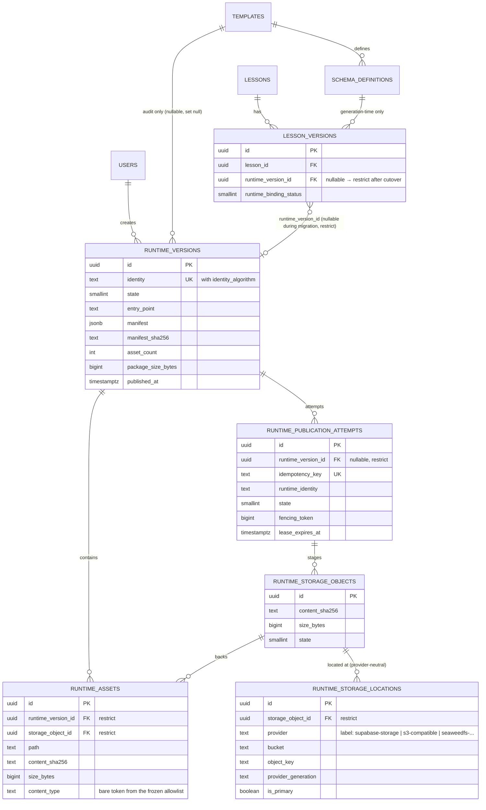

# Immutable Runtime Versions — Database Schema Design

**Document ID:** FUSAHA-ARCH-TR-003
**Status:** Design draft — for review only. Nothing in this document has been applied: no migration executed, no application code changed, no production or staging database touched.
**Date:** 2026-11-01
**Branch:** `feat/hide-authenticated-start-cta`
**Related:** `TEMPLATE_RUNTIME_ARCHITECTURE.md`, `TEMPLATE_RUNTIME_IMPLEMENTATION_PLAN.md`, `PERSISTENT_RUNTIME_STORAGE_ADR.md`, `poc/runtime-persistence/README.md`

This document converts the proven POC (`poc/runtime-persistence/`, 28/28 tests) and the frozen decisions (ADR §8 byte mode, §8.3 vectors, §8.4 byte placement) into a database design that follows the project's existing Drizzle conventions. It is Phase 2 ("Database Schema and Immutable Registry") material from the implementation plan: **design and review only**.

---

## 1. Current model and the problems this design solves

Verified from `database/schema/`:

- `templates` stores `html_player`, `blueprint`, `validation_script` as **mutable text**. Any edit changes rendering for every lesson that ever used the template.
- `lesson_versions` stores generated content in `content` (jsonb) and points to `schema_definition_id` (restrict). Rendering (`lib/dashboard/queries/lesson.ts`) joins `lessons → lesson_versions → schema_definitions → templates` and returns the **current** `templates.html_player`.
- `lessons.current_approved_version_id` selects the playable version; there is no runtime reference of any kind.
- `templates.preview_image` is a Data URI — no object storage exists in the app today.

**Problems:** template edits retroactively change lesson rendering; template/schema deletion risks orphaning lessons; identical player HTML is conceptually re-served per lesson with no deduplication; there is no content identity, so nothing can be verified for integrity.

**What this design adds:** immutable, content-addressed `runtime_versions` registered through a fenced publication protocol (proven in the POC), an explicit per-version reference from `lesson_versions`, provider-neutral storage records, and explicit historical states so current lessons keep working untouched until they are classified.

## 2. Proposed ERD



One `runtime_storage_objects` row may back many `runtime_assets` rows (identical files across packages share one object — content-addressed dedupe, proven in the POC). Provider details live only in `runtime_storage_locations`, so the object/asset/version layers are provider-neutral (ADR §5.3, §9 provider migration).

## 3. Table definitions

Naming follows project conventions: snake_case columns, camelCase TS fields, `uuid` PK with `defaultRandom()`, smallint-backed TS enums (project style — `enums.ts` documents why), explicit `onDelete` everywhere.

### 3.1 `runtime_versions` — immutable package identity and lifecycle

| Column | Type | Null | Notes |
|---|---|---|---|
| `id` | uuid PK | no | `defaultRandom()` |
| `identity` | text | no | `sha256-v1-<64 hex>` from frozen contract `runtime-package/v1` |
| `identity_algorithm` | text | no | `'runtime-package/v1'` (value frozen by ADR §8) |
| `state` | smallint | no | `RuntimeVersionState` enum (§3.7) |
| `package_kind` | smallint | no | `single-file` / `multi-file` |
| `entry_point` | text | no | normalized path, must match a manifest asset |
| `manifest` | jsonb | no | canonical manifest snapshot (sorted keys, frozen shape) |
| `manifest_sha256` | text | no | SHA-256 of canonical manifest bytes |
| `asset_count` | integer | no | `>= 1`, equals manifest assets length |
| `package_size_bytes` | bigint | no | sum of asset sizes |
| `source_template_id` | uuid | yes | audit only; `onDelete: "set null"` — template lifecycle never affects runtimes |
| `created_by` | uuid | yes | `onDelete: "set null"` |
| `failure_code` | text | yes | sanitized, never secret |
| `integrity_issue` | text | yes | sanitized operational code |
| `created_at`, `verified_at`, `published_at`, `failed_at`, `last_accessed_at` | timestamptz | yes except created_at | |

Constraints: `unique(identity_algorithm, identity)` (single-copy dedupe, enforced at DB); `check(asset_count >= 1)`; `check(package_size_bytes >= 0)`; state machine transitions enforced in application + optional trigger guard (§8).

### 3.2 `runtime_assets` — logical package files

| Column | Type | Null | Notes |
|---|---|---|---|
| `id` | uuid PK | no | |
| `runtime_version_id` | uuid FK → runtime_versions | no | `onDelete: "restrict"` |
| `storage_object_id` | uuid FK → runtime_storage_objects | no | `onDelete: "restrict"` |
| `path` | text | no | normalized relative POSIX path |
| `content_sha256` | text | no | 64 hex; equals the object's hash |
| `size_bytes` | bigint | no | |
| `content_type` | text | no | bare token from the frozen allowlist (ADR §8.2); delivery headers may add parameters |
| `provider_generation` | text | yes | ETag/version/generation captured at verification |
| `verified_at`, `created_at` | timestamptz | no | |

Constraints: `unique(runtime_version_id, path)`; `check(content_sha256 ~ '^[0-9a-f]{64}$')`. **No** `unique(storage_object_id)` — one object backs many assets across packages (documented deviation from the ADR's conditional suggestion, matching POC behavior).

### 3.3 `runtime_publication_attempts` — durable idempotency, leases, fencing

| Column | Type | Null | Notes |
|---|---|---|---|
| `id` | uuid PK | no | |
| `runtime_version_id` | uuid FK → runtime_versions | yes | `onDelete: "restrict"`; null only transiently before version row upsert |
| `identity_algorithm` | text | no | |
| `runtime_identity` | text | no | denormalized for reconciliation queries |
| `idempotency_key` | text | no | **unique** — caller retry identity |
| `request_fingerprint` | text | no | canonical identity (frozen contract) of the package |
| `state` | smallint | no | `RuntimePublicationAttemptState` (§3.7) |
| `lease_owner` | text | yes | worker identifier |
| `fencing_token` | bigint | no | monotonic per attempt; conditional updates per ADR §7.3 |
| `lease_expires_at` | timestamptz | yes | recovery seizes only after expiry or `failed` (proven, lease test 5/6/7) |
| `staging_namespace` | text | no | attempt-owned prefix |
| `expected_asset_count` | integer | no | `check > 0` |
| `expected_package_size_bytes` | bigint | no | `check >= 0` |
| `retry_count` | integer | no | default 0 |
| `last_error_code`, `last_error_at` | text / timestamptz | yes | sanitized |
| `created_at`, `updated_at`, `completed_at` | timestamptz | | |

Constraints: `unique(idempotency_key)` only. **Resolved decision (2026-11-01, §11):** the ADR §5.4 `unique(identity_algorithm, runtime_identity, request_fingerprint)` is **not** implemented. Under the frozen contract `request_fingerprint ≡ identity` (both are the canonical package identity), so the triple degenerates to `(algorithm, identity)` — redundant with `runtime_versions.unique(identity_algorithm, identity)` — while forbidding the proven-safe case of two different idempotency keys attempting the same package concurrently (POC lease test 4). Key-reuse misuse is already blocked by `unique(idempotency_key)` plus the fingerprint-conflict check required in §11 finding F2.

Indexes: `(state)`, `(lease_expires_at)` partial on active states, `(runtime_version_id)`, and a **non-unique** reconciliation index `(identity_algorithm, runtime_identity, request_fingerprint)`.

### 3.4 `runtime_storage_objects` — provider-neutral logical objects

| Column | Type | Null | Notes |
|---|---|---|---|
| `id` | uuid PK | no | stable logical object ID — survives provider migration |
| `content_sha256` | text | no | |
| `size_bytes` | bigint | no | |
| `content_type` | text | no | bare allowlist token |
| `state` | smallint | no | `RuntimeStorageObjectState` (§3.7) |
| `created_at`, `verified_at`, `last_verified_at` | timestamptz | | |

No provider columns here — locations only (§3.5). Constraint: `check(content_sha256 ~ '^[0-9a-f]{64}$')`.

### 3.5 `runtime_storage_locations` — adapter-owned physical placement

| Column | Type | Null | Notes |
|---|---|---|---|
| `id` | uuid PK | no | |
| `storage_object_id` | uuid FK → runtime_storage_objects | no | `onDelete: "restrict"` |
| `provider` | text | no | label (`supabase-storage`, `s3-compatible`, …) — not a design assumption |
| `bucket` | text | no | |
| `object_key` | text | no | adapter-owned; never client-selected |
| `provider_generation` | text | yes | persisted and rechecked (ADR §10) |
| `is_primary` | boolean | no | default true; one primary per object enforced in application/tx |
| `created_at`, `verified_at` | timestamptz | | |

Constraints: `unique(provider, bucket, object_key)`; index `(storage_object_id)`. Provider migration (ADR §10) inserts a new non-primary location, verifies, switches primary in a transaction — identity, asset paths, and lesson bindings never change.

### 3.6 `lesson_versions` — additive change only

Two new columns (expand phase):

| Column | Type | Null | Notes |
|---|---|---|---|
| `runtime_version_id` | uuid FK → runtime_versions | **yes** | `onDelete: "restrict"`; nullable during migration, made non-null only at Phase 6 contract per implementation plan |
| `runtime_binding_status` | smallint | no | `RuntimeBindingStatus` enum, default `Unbound` |

**Historical safety:** existing rows stay `Unbound` and render exactly as today (current template join). No backfill, no behavior change, no data loss in the expand phase. Cutover happens only through the classified backfill (§6–§7).

Consistency check (added during contract review): a bound version must reference a runtime —

```sql
CONSTRAINT lesson_versions_binding_chk
  CHECK (runtime_binding_status IN (0, 3, 4) OR runtime_version_id IS NOT NULL)
```

(`Bound=1` and `Legacy=2` require a runtime; `Unbound=0`, `Quarantined=3`, `Unrecoverable=4` may be null.)

### 3.7 Enums (TS smallint enums, project convention)

```ts
export enum RuntimeVersionState {
  Pending = 0, Published = 1, Failed = 2, Quarantined = 3, DeletionPending = 4, Collected = 5,
}
export enum RuntimePublicationAttemptState {
  Created = 0, Leased = 1, Uploading = 2, Verifying = 3, Finalizing = 4,
  Published = 5, Failed = 6, Expired = 7, Quarantined = 8,
}
export enum RuntimeStorageObjectState {
  Staged = 0, Available = 1, Missing = 2, Quarantined = 3, Deleted = 4,
}
export enum RuntimePackageKind {
  SingleFile = 0, MultiFile = 1,
}
export enum RuntimeBindingStatus {
  Unbound = 0, Bound = 1, Legacy = 2, Quarantined = 3, Unrecoverable = 4,
}
```

Mapping to ADR §7 text states is 1:1; documented so the numeric storage never obscures the state machine.

## 4. Drizzle schema proposal

New files `database/schema/runtime-versions.ts`, `runtime-assets.ts`, `runtime-publication-attempts.ts`, `runtime-storage-objects.ts`, `runtime-storage-locations.ts` (each with a header comment like existing files), re-exported from `database/schema/index.ts`. Excerpt of the core file:

```ts
import { pgTable, uuid, text, integer, bigint, smallint, jsonb, boolean, timestamp, unique, check } from "drizzle-orm/pg-core";
import { sql } from "drizzle-orm";
import { users } from "./users";
import { templates } from "./templates";
import { RuntimeVersionState, RuntimePackageKind } from "./enums";

// Immutable shared runtime package. One row per unique canonical package
// (unique identity_algorithm+identity). Bytes live in object storage via
// runtime_storage_objects/locations; this row is metadata + lifecycle only.
// Rendering a lesson never joins templates/schema_definitions after binding.
export const runtimeVersions = pgTable(
  "runtime_versions",
  {
    id: uuid("id").primaryKey().defaultRandom(),
    identity: text("identity").notNull(),
    identityAlgorithm: text("identity_algorithm").notNull(),
    state: smallint("state").notNull().default(RuntimeVersionState.Pending).$type<RuntimeVersionState>(),
    packageKind: smallint("package_kind").notNull().$type<RuntimePackageKind>(),
    entryPoint: text("entry_point").notNull(),
    manifest: jsonb("manifest").notNull(),
    manifestSha256: text("manifest_sha256").notNull(),
    assetCount: integer("asset_count").notNull(),
    packageSizeBytes: bigint("package_size_bytes", { mode: "number" }).notNull(),
    sourceTemplateId: uuid("source_template_id").references(() => templates.id, { onDelete: "set null" }),
    createdBy: uuid("created_by").references(() => users.id, { onDelete: "set null" }),
    failureCode: text("failure_code"),
    integrityIssue: text("integrity_issue"),
    createdAt: timestamp("created_at", { withTimezone: true }).notNull().defaultNow(),
    verifiedAt: timestamp("verified_at", { withTimezone: true }),
    publishedAt: timestamp("published_at", { withTimezone: true }),
    failedAt: timestamp("failed_at", { withTimezone: true }),
    lastAccessedAt: timestamp("last_accessed_at", { withTimezone: true }),
  },
  (table) => [
    unique().on(table.identityAlgorithm, table.identity),
    check("runtime_versions_asset_count_chk", sql`${table.assetCount} >= 1`),
    check("runtime_versions_package_size_chk", sql`${table.packageSizeBytes} >= 0`),
  ],
);
```

The remaining four tables follow the same pattern (full field lists in §3; `references(..., { onDelete: "restrict" })` on all runtime FKs; `unique(idempotencyKey)` on attempts; `unique(provider, bucket, objectKey)` on locations). `lesson-versions.ts` gains the two columns of §3.6 with `onDelete: "restrict"`.

## 5. Migration SQL draft — review only, not executed

Would be `database/migrations/0023_runtime_versions.sql`. Expand-only; nothing existing is altered except the additive nullable column:

```sql
-- 0023_runtime_versions.sql (DRAFT — for review; do not apply)
BEGIN;

CREATE TABLE runtime_versions (
  id uuid PRIMARY KEY DEFAULT gen_random_uuid(),
  identity text NOT NULL,
  identity_algorithm text NOT NULL,
  state smallint NOT NULL DEFAULT 0,
  package_kind smallint NOT NULL,
  entry_point text NOT NULL,
  manifest jsonb NOT NULL,
  manifest_sha256 text NOT NULL,
  asset_count integer NOT NULL CHECK (asset_count >= 1),
  package_size_bytes bigint NOT NULL CHECK (package_size_bytes >= 0),
  source_template_id uuid REFERENCES templates(id) ON DELETE SET NULL,
  created_by uuid REFERENCES users(id) ON DELETE SET NULL,
  failure_code text,
  integrity_issue text,
  created_at timestamptz NOT NULL DEFAULT now(),
  verified_at timestamptz,
  published_at timestamptz,
  failed_at timestamptz,
  last_accessed_at timestamptz,
  CONSTRAINT runtime_versions_identity_uk UNIQUE (identity_algorithm, identity),
  CONSTRAINT runtime_versions_sha_chk CHECK (manifest_sha256 ~ '^[0-9a-f]{64}$' AND identity ~ '^sha256-v1-[0-9a-f]{64}$')
);

CREATE TABLE runtime_storage_objects (
  id uuid PRIMARY KEY DEFAULT gen_random_uuid(),
  content_sha256 text NOT NULL CHECK (content_sha256 ~ '^[0-9a-f]{64}$'),
  size_bytes bigint NOT NULL CHECK (size_bytes >= 0),
  content_type text NOT NULL,
  state smallint NOT NULL DEFAULT 0,
  created_at timestamptz NOT NULL DEFAULT now(),
  verified_at timestamptz,
  last_verified_at timestamptz
);

CREATE TABLE runtime_storage_locations (
  id uuid PRIMARY KEY DEFAULT gen_random_uuid(),
  storage_object_id uuid NOT NULL REFERENCES runtime_storage_objects(id) ON DELETE RESTRICT,
  provider text NOT NULL,
  bucket text NOT NULL,
  object_key text NOT NULL,
  provider_generation text,
  is_primary boolean NOT NULL DEFAULT true,
  created_at timestamptz NOT NULL DEFAULT now(),
  verified_at timestamptz,
  CONSTRAINT runtime_storage_locations_uk UNIQUE (provider, bucket, object_key)
);
CREATE INDEX runtime_storage_locations_object_idx ON runtime_storage_locations(storage_object_id);

CREATE TABLE runtime_assets (
  id uuid PRIMARY KEY DEFAULT gen_random_uuid(),
  runtime_version_id uuid NOT NULL REFERENCES runtime_versions(id) ON DELETE RESTRICT,
  storage_object_id uuid NOT NULL REFERENCES runtime_storage_objects(id) ON DELETE RESTRICT,
  path text NOT NULL,
  content_sha256 text NOT NULL CHECK (content_sha256 ~ '^[0-9a-f]{64}$'),
  size_bytes bigint NOT NULL CHECK (size_bytes >= 0),
  content_type text NOT NULL,
  provider_generation text,
  verified_at timestamptz NOT NULL DEFAULT now(),
  created_at timestamptz NOT NULL DEFAULT now(),
  CONSTRAINT runtime_assets_path_uk UNIQUE (runtime_version_id, path)
);
CREATE INDEX runtime_assets_object_idx ON runtime_assets(storage_object_id);

CREATE TABLE runtime_publication_attempts (
  id uuid PRIMARY KEY DEFAULT gen_random_uuid(),
  runtime_version_id uuid REFERENCES runtime_versions(id) ON DELETE RESTRICT,
  identity_algorithm text NOT NULL,
  runtime_identity text NOT NULL,
  idempotency_key text NOT NULL UNIQUE,
  request_fingerprint text NOT NULL,
  state smallint NOT NULL DEFAULT 0,
  lease_owner text,
  fencing_token bigint NOT NULL DEFAULT 0,
  lease_expires_at timestamptz,
  staging_namespace text NOT NULL,
  expected_asset_count integer NOT NULL CHECK (expected_asset_count > 0),
  expected_package_size_bytes bigint NOT NULL CHECK (expected_package_size_bytes >= 0),
  retry_count integer NOT NULL DEFAULT 0,
  last_error_code text,
  last_error_at timestamptz,
  created_at timestamptz NOT NULL DEFAULT now(),
  updated_at timestamptz NOT NULL DEFAULT now(),
  completed_at timestamptz
);
CREATE INDEX runtime_publication_attempts_state_idx ON runtime_publication_attempts(state);
CREATE INDEX runtime_publication_attempts_lease_idx ON runtime_publication_attempts(lease_expires_at);
CREATE INDEX runtime_publication_attempts_identity_idx ON runtime_publication_attempts(runtime_identity);
-- Non-unique reconciliation index (decision §11: the ADR §5.4 triple unique is NOT used).
CREATE INDEX runtime_publication_attempts_fingerprint_idx
  ON runtime_publication_attempts(identity_algorithm, runtime_identity, request_fingerprint);

-- Expand phase only: additive, nullable, defaults keep every existing row valid.
ALTER TABLE lesson_versions
  ADD COLUMN runtime_version_id uuid REFERENCES runtime_versions(id) ON DELETE RESTRICT,
  ADD COLUMN runtime_binding_status smallint NOT NULL DEFAULT 0,
  ADD CONSTRAINT lesson_versions_binding_chk
    CHECK (runtime_binding_status IN (0, 3, 4) OR runtime_version_id IS NOT NULL);

CREATE INDEX lesson_versions_runtime_idx ON lesson_versions(runtime_version_id);

COMMIT;
```

Immutability guard (optional second step, flagged for review): a `BEFORE UPDATE` trigger on `runtime_versions` that raises when a row in state `Published` (or terminal states) attempts to change identity/manifest/asset columns, plus lifecycle-only columns updated only via the state machine. This complements — never replaces — the application-level enforcement proven in the POC, because the Supabase service role bypasses RLS.

## 6. Current-data migration plan

Sequenced per the implementation plan (expand → backfill → dual-read → cutover → contract):

1. **Inventory (Phase 0):** classify every approved `lesson_versions` row against the current `templates.html_player`: does the lesson's generation time match the template's current content? (It cannot be proven for rows generated before any snapshot existed — record this as data quality, per implementation plan §6.2.)
2. **Expand:** run §5. All rows become `runtime_binding_status = Unbound`; zero behavior change.
3. **Register player packages:** for each distinct current `html_player` (+ fixed execution contract), build a single-file package (`index.html` = player HTML, frozen `runtime-package/v1` identity), publish through the proven protocol, record `source_template_id` for audit.
4. **Backfill (classified, never inferred):**
   - Recoverable: bind approved versions whose template content is verifiably unchanged → `Bound`.
   - Legacy: approved versions playable via a deliberately created legacy runtime snapshot → `Legacy`.
   - Ambiguous/unrecoverable: `Quarantined` / `Unrecoverable` — explicitly not playable through the new resolver, never silently rendered from the current template (ADR §7 invariant, implementation plan rollback rules).
5. **Dual-read:** resolver prefers `runtime_version_id`; `Unbound` keeps today's template join with telemetry. No non-null enforcement until Phase 6 acceptance.

Idempotent backfill with checkpoints; reruns never overwrite an immutable runtime.

## 7. Historical compatibility guarantees

- `ON DELETE RESTRICT` from `lesson_versions` to `runtime_versions`: a runtime can never be deleted while referenced; template/schema deletion cannot touch runtimes (`set null` on the audit FK only).
- `Quarantined`/`Unrecoverable` versions fail closed: the resolver must throw/report, never fall back to the mutable template (ADR §3 invariant 14).
- `templates`/`schema_definitions` remain generation-time sources during migration; rendering stops joining them only after the evidence gate (implementation plan Phase 4→6).
- Rollback = restore previous resolver release while keeping created runtime rows (non-destructive).

## 8. Constraints and indexes summary

| Kind | Definition |
|---|---|
| Unique | `runtime_versions(identity_algorithm, identity)`; `runtime_publication_attempts(idempotency_key)`; `runtime_assets(runtime_version_id, path)`; `runtime_storage_locations(provider, bucket, object_key)` |
| FK cascade | None into runtime tables: all `restrict` (assets, attempts, locations) except audit FKs `set null` (source_template_id, created_by) |
| Checks | asset_count ≥ 1; sizes ≥ 0; SHA formats `^[0-9a-f]{64}$`; identity format `^sha256-v1-[0-9a-f]{64}$`; `lesson_versions_binding_chk` (Bound/Legacy require `runtime_version_id`) |
| Indexes | attempts `(state)`, `(lease_expires_at)`, `(runtime_identity)`, non-unique reconciliation `(identity_algorithm, runtime_identity, request_fingerprint)`; assets `(storage_object_id)`; locations `(storage_object_id)`; lesson_versions `(runtime_version_id)` |
| Immutability | application state machine (proven) + optional trigger guard on published package columns; provider-level no-overwrite at the storage layer |

## 9. Required integration tests (before any cutover)

From the POC (already proven — must be re-proven against the production schema in staging):

1. Exact frozen vectors V1–V7 reproduce from the production canonicalizer.
2. Duplicate `(identity_algorithm, identity)` insert is idempotent (register-or-reuse).
3. Fencing: expired lease and stale token refuse finalize; recovery converges on one published runtime; `failed`-state race cannot corrupt a published attempt.
4. Concurrent publishers (cross-process) with one or many idempotency keys converge on exactly one runtime; SHA-256 verification of every stored byte.
5. Published asset mutation rejected at the provider; DB update of published package columns rejected.
6. Runtime deletion refused while a `lesson_versions` row references it; lesson deletion never cascades into runtime deletion.
7. Backfill rerun safety; reference-count reconciliation query; golden dashboard/public renders identical before/after binding.
8. Idempotency conflict: reusing an idempotency key with a different package fingerprint fails cleanly with no side effects (§11 finding F2).

## 10. Open decisions and risks

| Item | Status |
|---|---|
| ADR §5.4 `unique(algorithm, identity, fingerprint)` vs proven multi-key concurrency | **Resolved 2026-11-01 (§11):** constraint omitted; reconciliation index + fingerprint-conflict check instead. ADR amendment proposed in §11.5 — awaiting approval |
| Storage provider (Supabase vs S3-compatible) | Open by design (ADR §4 decision rule); schema is provider-neutral; requires RPO/RTO/region verification before Phase 2 execution |
| Immutability trigger vs grants-only enforcement on Supabase | Open — must be verified on a sanitized staging copy (service role bypasses RLS) |
| Which worker reaps expired leases in production | Open — POC uses explicit recovery; production needs a reaper with bounded retries and quarantine (ADR §7.2) |
| `templates.html_player` snapshot → single-file package boundary | Needs contract review (implementation plan Phase 1 gate) |
| Numeric smallint enums vs ADR text states | Resolved by mapping table §3.7 (project convention wins, semantics unchanged) |
| Live DB constraints/RLS/grants | Unverified (documented in ADR §2.1/§17) — staging rehearsal required before execution |
| Retention/collection policy for deprecated runtimes | Open (implementation plan §9.3) — collection stays disabled until accepted |

---

## 11. Phase 1 contract review record (2026-11-01)

### 11.1 Unique-constraint decision: six questions, six answers

**Q1 — meanings.** `algorithm` = the canonicalization algorithm name (`runtime-package/v1`, frozen by ADR §8). `identity` = its output, `sha256-v1-<64 hex>`, computed over the framed stream of the canonical manifest plus the exact file bytes. `fingerprint` = the canonical package fingerprint; this design (and the POC) compute it with the same frozen algorithm, so **`request_fingerprint ≡ identity`** by construction.

**Q2 — two identities, same `algorithm` + `identity`?** Impossible: `identity` is the value being fixed. Same algorithm + same identity string is one value; a SHA-256 collision is out of scope.

**Q3 — two fingerprints for one identity?** No. The identity already covers the canonical manifest and every file's bytes; any input difference that would change the fingerprint also changes the identity (frozen vectors V7a–V7c prove manifest changes change the identity). Two fingerprints for one identity would require different canonical inputs mapping to one SHA-256.

**Q4 — re-publishing the same identity with different data?** Under the frozen contract this is a contradiction in terms: different data ⇒ different manifest/asset hashes ⇒ different identity (vectors V3/V5/V6/V7). Same identity ⇒ identical package ⇒ idempotent register-or-reuse: return the existing published runtime, insert nothing, upload nothing. Same `idempotency_key` with a different package is the only real misuse: it must fail with an idempotency conflict and no side effects (ADR §9.1 step 3).

**Q5 — does the triple unique deliver the invariant?** No, on both counts:
- *Redundant:* with `fingerprint ≡ identity`, `unique(algorithm, identity, fingerprint)` ≡ `unique(algorithm, identity)`, which already exists on `runtime_versions` where it matters.
- *Harmful:* it rejects legitimate concurrency. Two different callers (different `idempotency_keys`) attempting the same package is proven safe by the POC (lease suite test 4: two attempt rows converge on one published runtime). The constraint would raise on the second insert.

```sql
-- The triple unique REJECTS this legitimate second attempt:
INSERT INTO runtime_publication_attempts
  (id, identity_algorithm, runtime_identity, idempotency_key, request_fingerprint, state, staging_namespace, expected_asset_count, expected_package_size_bytes)
VALUES ('a1','runtime-package/v1','sha256-v1-X','teacher-A-1','sha256-v1-X',0,'s',1,5);
INSERT INTO runtime_publication_attempts
  (id, identity_algorithm, runtime_identity, idempotency_key, request_fingerprint, state, staging_namespace, expected_asset_count, expected_package_size_bytes)
VALUES ('a2','runtime-package/v1','sha256-v1-X','teacher-B-1','sha256-v1-X',0,'s',1,5);
-- ERROR: duplicate key value violates unique constraint "..._algorithm_identity_fingerprint_key"
-- ...even though the POC proves both attempts converge on ONE published runtime.
```

```sql
-- Key-reuse misuse is already covered WITHOUT the triple unique:
-- (a) the second insert with the same key is rejected by:
--     unique(idempotency_key)
-- (b) reusing a key with a different package must be rejected by the
--     fingerprint-conflict check in the register transaction (finding F2).
-- The triple adds no protection here.
```

**Q6 — the correct alternative.** `unique(idempotency_key)` on attempts (kept) + `unique(identity_algorithm, identity)` on `runtime_versions` (kept) + application-level fingerprint-conflict check at re-lease (F2) + **non-unique** index `(identity_algorithm, runtime_identity, request_fingerprint)` for reconciliation and equivalency queries.

**Decision: the ADR §5.4 triple unique is omitted from this design; the conflict is resolved in favor of the proven POC behavior.**

### 11.2 Full contract review findings

| # | Area | Finding | Disposition |
|---|---|---|---|
| F1 | Identity / immutability | V1 identity covers manifest + bytes; `unique(identity_algorithm, identity)` enforces single copy; no silent v0 equality (ADR §8.1 legacy labeling) | Consistent |
| F2 | Idempotency | **Gap:** the PG POC's `beginAttempt` re-leases on `idempotency_key` conflict without verifying the stored `request_fingerprint` matches the incoming package — ADR §9.1 step 3 is enforced only in the in-memory model. Same key + different package would hijack the attempt row. Production register must check fingerprint match on re-lease and fail with `conflict` | Implementation requirement + integration test §9.8 |
| F3 | Fencing / lease | Guard (`fencing_token` + `lease_expires_at > now()`), conditional seize after expiry or `failed`, conditional `markFailed` — all POC-proven; reaper ownership remains an operational open item (§10) | Consistent (proven) |
| F4 | Lesson binding | `Bound`/`Legacy` require `runtime_version_id` — now enforced by `lesson_versions_binding_chk`; `restrict` FK prevents runtime deletion while referenced; quarantined/unrecoverable fail closed | Consistent (check added this review) |
| F5 | Historical independence | Rendering stops joining `templates`/`schema_definitions` only after binding; audit FKs `set null`; no cascade into runtime tables | Consistent |
| F6 | Provider neutrality | Objects carry no provider columns; locations hold provider/bucket/key/generation; migration path preserves identity and bindings | Consistent |

No contradictions remain between the contract elements.

### 11.3 Proposed ADR amendment (awaiting approval — not yet applied)

Section **ADR §5.4 "Constraints/indexes"**, replace:

> `- unique(identity_algorithm, runtime_identity, request_fingerprint) for equivalent package attempts.`

with:

> `- Non-unique index on (identity_algorithm, runtime_identity, request_fingerprint) for reconciliation. Uniqueness of published packages is enforced by runtime_versions unique(identity_algorithm, identity); attempt equivalency under different idempotency keys is safe and must converge to a single published runtime (proven by the POC). Reusing an idempotency key with a different request_fingerprint must fail with an idempotency conflict (§9.1).`

Scope is that single constraint bullet only.

---

**Execution boundary:** this document creates nothing. Applying it requires a separate, explicit approval that opens the implementation-plan Phase 2 gate.
