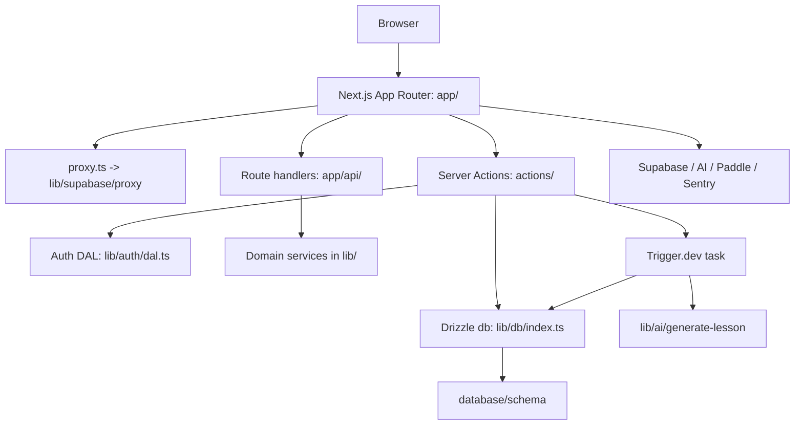
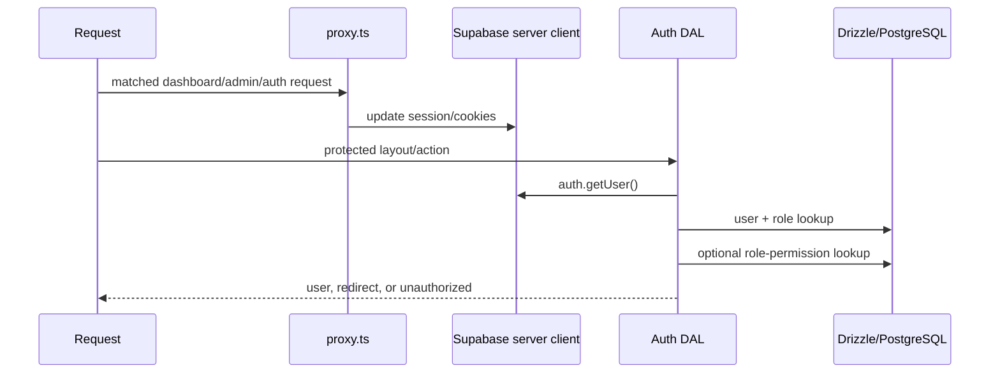
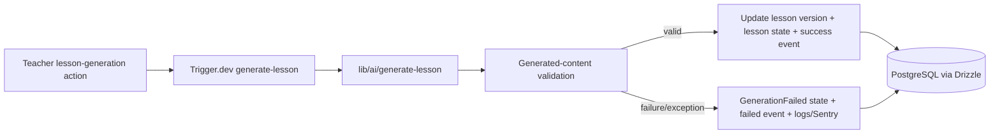

# Fusaha — System Architecture Map

> Current-state map of the Fusaha repository on `v0/homepage-redesign`. Claims marked **Verified** are supported by checked source files. Claims marked **Boundary/Unknown** require runtime, deployment, or Supabase inspection. This document describes the implemented system, not the product roadmap.

## 1. Purpose and scope

This map explains the current Next.js application boundaries, routing, authentication and authorization flow, persistence, server operations, background generation, external-service references, and verification limits. It intentionally does not define future library storage, internal file hosting, OCR, or AI processing for books.

## 2. High-level system overview

**Verified:** Fusaha is a Next.js 16 App Router application using React 19, TypeScript, `next-intl`, Supabase SSR clients, Drizzle ORM over PostgreSQL, AI SDK integrations, Trigger.dev, Sentry, and Paddle-related modules. The dependency references and scripts are in `package.json`; database access is implemented in `lib/db/index.ts`.

**Boundary:** This diagram describes code boundaries and imports. It does not prove that every referenced external service is enabled or operational in production.

## 3. Application routing and UI layers

### 3.1 Route organization

**Verified from the repository tree and route constants:**

- Public pages: `/`, `/products`, `/resources`, `/help`, `/library`, and `/library/[slug]`.
- Authentication pages: `/auth/login`, `/auth/signup`, `/auth/forgot-password`, `/auth/reset-password`, and `/auth/callback`.
- Teacher workspace: `/dashboard/**` and `/lesson-studio`.
- Administrative workspace: `/admin/**`, including teachers, employees, roles, lessons, templates, schema, settings, audit logs, and generation events.
- Shared lesson routes: `/l/[token]` and its frame route.
- Access-denied route: `/unauthorized`.
- Paddle webhook: `/api/webhooks/paddle`.

`constants/routes.ts` is the central route-name object for the application. It includes the library route and the public navigation destinations.

### 3.2 Layouts and navigation

- `app/layout.tsx` is the root shell. It establishes locale/direction, Arabic font and theme providers, translations, tooltip support, and global loading UI.
- `app/(public)/layout.tsx` is the shared public website shell. It renders `PublicHeader`, the route content, and `SiteFooter` exactly once.
- `app/_components/public-header.tsx` is the shared public header. Its desktop navigation includes the Arabic link `المكتبة` between `المنتجات` and `الموارد`, using `ROUTES.library`.
- `app/_components/site-footer.tsx` is the single source of truth for the complete public footer. Public pages must not render footer markup directly.
- `components/mobile-navigation.tsx` provides the responsive public navigation and includes the same library destination.
- Public pages are grouped under `app/(public)/`; authentication and application workspaces remain outside this shell.
- `app/dashboard/layout.tsx` calls `requireTeacher()` and renders `DashboardHeader` before teacher content.
- The admin area has its own sidebar and layout components under `app/admin/`; the current authorization model is role/permission based rather than public navigation based.
- Shared UI primitives live under `components/ui/`; feature-specific components are colocated under route `_components` directories.

### 3.3 Current library boundary

**Verified:** `app/library/page.tsx`, `app/library/[slug]/page.tsx`, `app/library/_components/library-browser.tsx`, and `content/library.ts` implement a public, static TypeScript catalog. It supports metadata display, client-side search/filter behavior, and detail pages. Current records use metadata-only access; the content module does not define database IDs, storage paths, uploads, internal files, or publisher URLs.

The library is therefore a UI/content feature, not a database-backed library domain. `/resources` remains a separate public resource page.

## 4. Authentication and authorization flow

### 4.1 Authentication

**Verified:** `lib/supabase/server.ts` creates a server Supabase client using the project’s public URL/key variables and request cookies. `lib/supabase/proxy.ts` is called by `proxy.ts`, whose matcher covers `/dashboard/:path*`, `/admin/:path*`, and `/auth/login`.

The proxy is a request/session boundary and fast redirect mechanism. It is not the complete authorization decision.

### 4.2 Application authorization

**Verified in `lib/auth/dal.ts`:**

1. `getCurrentUser()` calls `supabase.auth.getUser()`.
2. It loads the local user row and role through Drizzle joins against `users` and `roles`.
3. Inactive or missing local profiles are treated as unauthenticated.
4. `requireTeacher()` permits only `roleName === "teacher"` and redirects otherwise.
5. `requireAdmin()` permits any active role other than teacher; it is an admin-platform gate, not a fine-grained permission check.
6. `requirePermission(key)` calls `requireAdmin()`, then checks the user role against `rolePermissions` and `permissions`.
7. Missing permission grants redirect to `/unauthorized`.
8. `getRolePermissionKeys()` supplies permission keys for server-rendered UI filtering such as the admin sidebar.

**Important distinction:** Supabase authentication establishes the authenticated identity. The repository’s fine-grained application authorization is implemented through local `users`, `roles`, `permissions`, and `rolePermissions` records. The existence of these tables does not prove the live database has the expected rows or RLS policies.

### 4.3 Protected boundaries

- Teacher dashboard pages are protected by the dashboard layout’s `requireTeacher()` call.
- Admin pages are expected to use `requireAdmin()` or `requirePermission()` through admin layouts/pages/actions; individual call sites must be checked when making authorization claims.
- Server actions are not protected merely because their files are under `actions/`; each sensitive action must perform its own server-side session and permission checks.
- Public library pages do not require authentication because their current data is static content.

**Boundary/Unknown:** Live Supabase RLS, Data API exposure, JWT/app-metadata configuration, and deployed proxy behavior cannot be established from this repository alone.

## 5. Data and persistence flow

### 5.1 Database access

**Verified:** `lib/db/index.ts` creates a Drizzle PostgreSQL client from `DATABASE_URL`, uses `postgres` with `prepare: false` for the transaction-mode pooler configuration, and exports a lazy proxy that preserves the normal Drizzle query API. The schema object is imported from `database/schema/index.ts`.

`drizzle.config.ts` and the numbered SQL files under `database/migrations/` define the repository migration workflow. `package.json` exposes `db:migrate` and `db:seed` scripts. No migration is run by this document update.

### 5.2 Active schema domains

**Verified from `database/schema/index.ts`:** the active schema exports:

- Identity/authorization: users, roles, permissions, role-permissions.
- Teaching content: lessons, lesson versions, folders, share links, templates, schema definitions.
- Operations: generation events, audit logs, system settings, app settings.
- Billing/credits: credit packages, purchases, credit ledger entries.

`database/schema/deferred.ts` is not exported by the active schema index and should not be described as current persistence capability.

### 5.3 Static and temporary data

- `content/library.ts` and `content/resources.ts` are static TypeScript data modules loaded by the application; current library records are not database records.
- PDF/DOCX parsing dependencies and AI extraction helpers belong to lesson source/generation workflows. Their presence does not establish persistent book-file storage.
- Lesson generation writes durable lesson/version/generation-event records, while request payloads and extracted source material may be transient during the workflow.

## 6. Server actions, APIs, and background jobs

### 6.1 Server actions and route handlers

`actions/` contains server actions for auth, lessons, folders, generation, purchases, and admin/settings domains. `app/api/` contains route handlers, including the Paddle webhook. Domain query modules are grouped under `lib/admin/queries/` and `lib/dashboard/queries/`.

The exact authorization and validation guarantees are action-specific. The intended safe path is: obtain the authenticated user through the auth DAL, validate input with the relevant `validation/` schema, authorize the operation server-side, then use Drizzle/domain services for persistence.

### 6.2 Lesson-generation workflow

**Verified in `src/trigger/generate-lesson.ts`:** the `generate-lesson` Trigger.dev task has a maximum duration of 600 seconds. It receives lesson/version/teacher identifiers, locale, source information, prompts, blueprint, and validation data; calls `lib/ai/generate-lesson`; validates the result; and updates the database in a transaction.

The task records success/failure generation events, logs through the shared logger and Trigger logger, and captures exceptions with Sentry when `SENTRY_DSN` is available. The source comments state that generation failures do not refund credits because the AI call/retries incur cost.

**Verified:** this task is asynchronous and separate from the Next.js request timeout. The exact enqueueing call is owned by the generation action/flow and should be traced separately when modifying that feature.

## 7. External integrations and configuration boundaries

The following integrations are referenced by code or dependencies:

| Integration | Current code purpose | Evidence/configuration boundary |
|---|---|---|
| Supabase | Auth/session clients and request cookies | `lib/supabase/`, `@supabase/ssr`, `@supabase/supabase-js`; public URL/key variable names are referenced by the client modules |
| PostgreSQL/Supabase database | Persistent application records | `lib/db/index.ts`, Drizzle schema, migrations, `DATABASE_URL` |
| AI SDK/provider | Lesson content generation | `lib/ai/`, AI SDK/provider dependencies, generation task |
| Trigger.dev | Long-running lesson generation | `src/trigger/generate-lesson.ts`, `trigger.config.ts`, Trigger dependencies |
| Sentry | Next.js and Trigger error reporting | Sentry config files and `SENTRY_DSN` usage |
| Paddle | Billing and webhook processing | `lib/paddle.ts`, `lib/paddle-client.ts`, purchases actions, `app/api/webhooks/paddle/route.ts` |
| PDF/DOCX libraries | Lesson source extraction | `lib/ai/` and package dependencies; not a persistent library-storage service |

**Configuration rule:** this map names variables only and never records values. Imports or variable references prove an integration boundary exists in code, not that the service is connected, correctly configured, authorized, or healthy in deployment.

**Not currently evidenced:** a configured storage bucket for the educational library, persistent internal book files, email delivery, or a database-backed library search/index.

## 8. Important domain and dependency relationships

- Public navigation depends on `constants/routes.ts`; the header and mobile navigation use the same route constants.
- Dashboard access depends on Supabase identity plus a local user/role lookup through Drizzle.
- Admin UI access depends on the baseline admin gate and, where used, role-permission grants.
- Lessons relate to lesson versions and generation events; teacher ownership and role checks are enforced through application queries/actions.
- Generation tasks depend on the AI generation helper, validation, lesson/version schemas, generation-event schema, logging, and Sentry.
- Billing UI/actions depend on Paddle helpers and the credit/purchase/ledger schema domain.
- The current library depends only on static content, route-local UI, Next navigation, and public image assets; it does not depend on Supabase, Drizzle, Storage, or authentication.

## 9. Testing and verification boundaries

### Repository tests

**Verified locations:**

- `lib/auth/*.test.ts`: auth, OAuth, PKCE, and recovery behavior.
- `lib/ai/*.test.ts`: AI generation and validation-related behavior.
- `lib/db/index.test.ts`: database test helpers/coverage.
- `lib/lesson-levels.test.mjs`: lesson-level utility behavior.
- `package.json`: `node --test` is the repository test command; `pnpm lint` runs ESLint.

The tests document selected unit/integration boundaries, not complete end-to-end coverage of every route or deployed service.

### What cannot be proven from source alone

- Live RLS policies, Storage policies/buckets, Data API exposure, and production migration state.
- Whether all environment variables are present and valid in each deployment environment.
- External Paddle, AI, Trigger.dev, Sentry, or Supabase credentials and webhook configuration.
- Production proxy behavior, deployment routing, quotas, backup/retention, and observability delivery.
- Browser behavior across all locales and device sizes without running the relevant end-to-end checks.

## 10. Known gaps, uncertainties, and documentation limitations

- The architecture map cannot infer live database state from Drizzle schema or migration files.
- Application authorization and database RLS are separate controls; repository code verifies the former patterns but not live Supabase policy correctness.
- The current public library is intentionally metadata-only and static. It must not be documented as a database-backed catalog, file store, reader, or upload system.
- `requireAdmin()` is a broad platform gate for non-teacher roles. Fine-grained protection requires `requirePermission()` and the corresponding live permission grants.
- The existence of integration modules does not prove operational connectivity.
- The route tree and repository tree are representative documentation; new route-local files should be checked against source when extending this map.

## 11. Links to related documentation

- [`REPOSITORY_TREE.md`](./REPOSITORY_TREE.md) — verified repository index.
- [`ADR-001-navigation-shells.md`](./ADR-001-navigation-shells.md) — navigation shell ownership.
- [`BOOK_LIBRARY_SPECIFICATION.md`](../product/BOOK_LIBRARY_SPECIFICATION.md) — product/library direction; not equivalent to current implementation.
- [`docs/data-model.md`](../data-model.md) — broader data-model documentation.
- [`docs/ai-pipeline.md`](../ai-pipeline.md) — AI pipeline context.
- [`docs/api-reference.md`](../api-reference.md) — API reference material.

## Maintenance rule

Update this map when a route boundary, shell, persistence domain, authorization mechanism, background task, integration, or deployment boundary changes. Label claims as current, planned, or unresolved, and keep future product proposals separate from implemented architecture.
