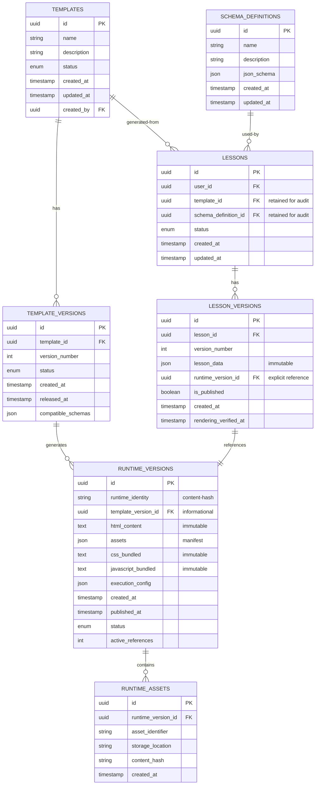
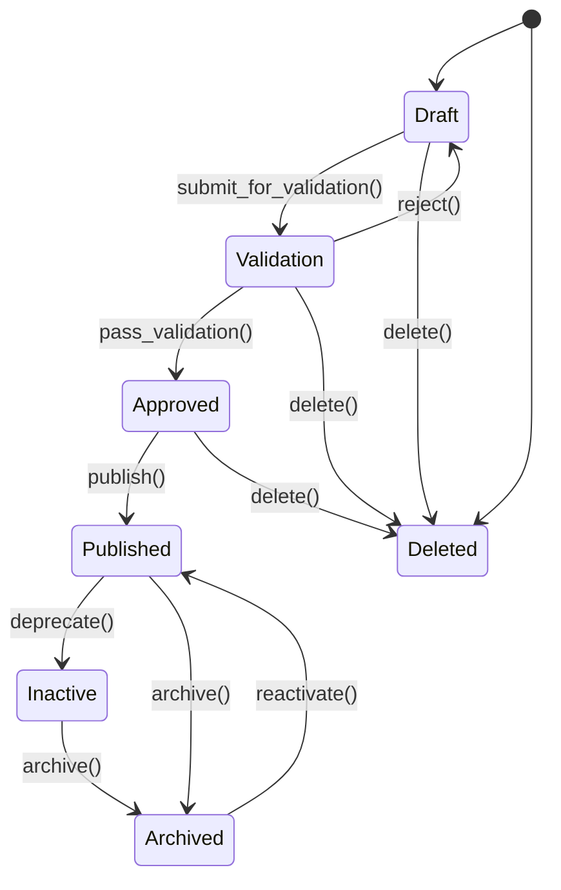
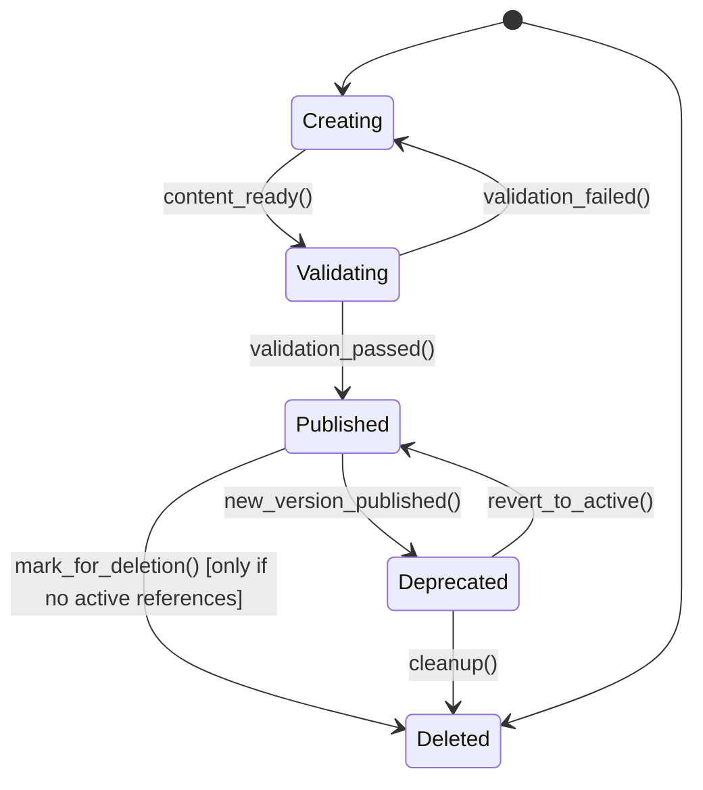
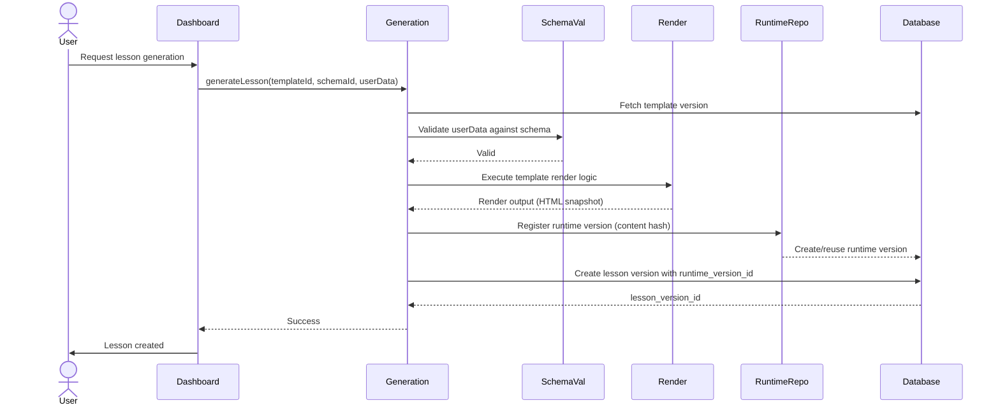
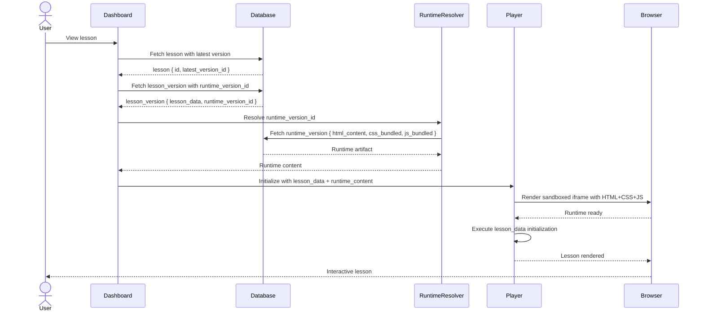
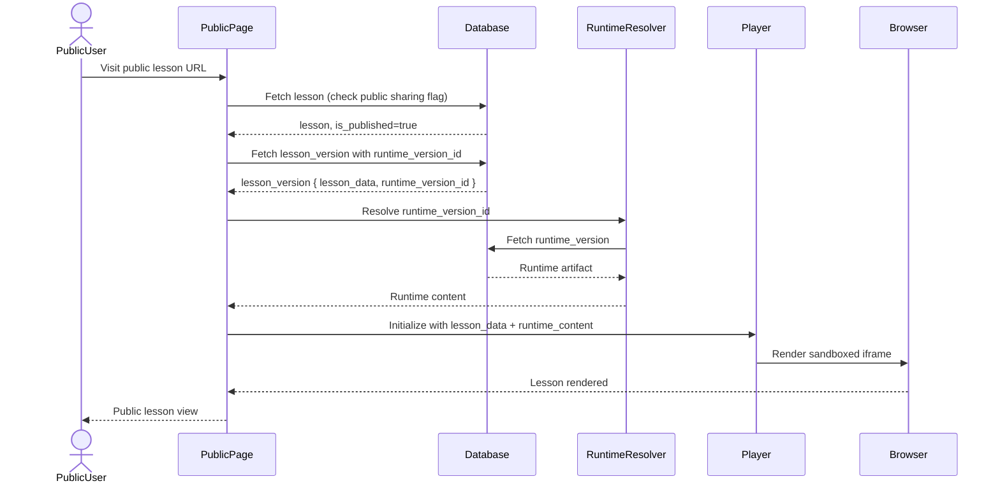

# Template Runtime Architecture
## Immutable Shared Runtime Versioning for Fusaha

**Document ID:** FUSAHA-ARCH-TR-001  
**Document Type:** Platform Architecture Specification  
**Architecture Level:** Platform-Wide System Design  
**Status:** Initial Architecture Specification  
**Effective Date:** October 2026  
**Language:** English  
**Audience:** Principal Engineers, Software Architects, Backend Engineers, Platform Engineers, and Future Contributors

---

## 1. Executive Summary

This document establishes the authoritative architectural standard for Fusaha's template management, lesson generation, runtime versioning, and lesson execution lifecycle.

The core architectural principle is:

> **Immutable Shared Runtime Versions:** Each approved template runtime version must be stored as a single immutable, independently addressable artifact. Multiple lessons belonging to different users may reference and share the exact same runtime version without duplicating its underlying files. A generated lesson must remain operationally independent of the administrative template record and the original schema definition used during generation.

This architecture ensures that lessons remain functional even after templates or schemas are modified or deleted, eliminates runtime duplication, standardizes the template integration contract, and provides a scalable foundation for future template diversity.

---

## 2. Current State Analysis

### 2.1 Repository Evidence and Verified Implementation

This section documents the existing Fusaha implementation as verified through direct inspection of the codebase.

#### 2.1.1 Database Schema

**Location:** `database/schema/`

The current schema defines the following relevant entities:

**Templates Table** (`database/schema/templates.ts`)
- Stores `id`, `name`, `html_player`, `blueprint`, `validation_script`, optional `preview_image`, `active`, and timestamps
- Stores the template player and generation-support fields as mutable database text
- No active template-version table was verified in the inspected schema
- **Verified:** `schema_definitions.template_id` points to the template record

**Template Versions:** No active `template_versions` table was verified in the inspected schema. The current repository uses the mutable `templates` record as the template source.

**Schema Definitions Table** (`database/schema/schema-definitions.ts`)
- Stores admin-defined level/instruction fields and a required `template_id`
- `template_id` references `templates.id` with restrict semantics in the Drizzle definition
- The schema is used during generation; its live database policies and deployed rows are unverified

**Lessons Table** (`database/schema/lessons.ts`)
- Stores `id`, `owner_id`, `name`, `current_approved_version_id`, state, folder, soft-delete timestamp, and timestamps
- Does not contain `template_id` or `schema_definition_id`
- The approved lesson version is selected through `current_approved_version_id`
- **Current State Finding:** No explicit `runtime_version_id` reference

**Lesson Versions Table** (`database/schema/lesson-versions.ts`)
- Stores `id`, `lesson_id`, `version_number`, status, required `schema_definition_id`, JSONB `content`, source type, and approval timestamps
- Uses `onDelete: "restrict"` for the schema-definition foreign key in the Drizzle definition
- **Current State Finding:** Not explicitly linked to runtime information or a template snapshot

**Generation Events Table** (`generation-events.ts`)
- Logs generation operations: `id`, `lesson_id`, `template_id`, `schema_definition_id`, `status`, `error`, `created_at`, `updated_at`
- Provides audit trail
- **Verified:** Generation metadata is tracked separately from runtime state

#### 2.1.2 Generation Pipeline

**Location:** `actions/generation.ts`, `src/trigger/generate-lesson.ts`

**Verified Generation Flow:**
1. Template is selected by ID
2. Schema definition is selected by ID
3. `generateLesson` action is called with `templateId` and `schemaDefinitionId`
4. Generation is queued to `generate-lesson` trigger
5. Trigger handler executes generation logic
6. Generated content is stored in `lesson_versions.content`
7. The lesson version retains `schema_definition_id`; the template is resolved during generation through the schema definition

**Current State Finding:** 
- Runtime versioning is not explicitly tracked at lesson creation
- Lesson data includes raw content from template HTML execution
- Template and schema IDs are stored denormalized at lesson time
- No content hashing or runtime identity mechanism exists

#### 2.1.3 Lesson Rendering and Dashboard

**Location:** `lib/dashboard/queries/lesson.ts`

**Verified Rendering Path:**
- Lessons are retrieved with template and schema context
- Template HTML is loaded from the `templates` table
- Lesson data is combined with template context for display
- **Current State Finding:** Rendering requires access to the original template record

#### 2.1.4 Public Lesson Sharing

**Location:** App routes (dashboard, public sharing pages)

**Repository boundary:** Public sharing routes and frame handlers exist, but the exact public query path must be verified separately. The target architecture requires public rendering to resolve only lesson version plus immutable runtime; this document does not claim that the current public path already satisfies that requirement.

#### 2.1.5 Template HTML Player

**Location:** `components/template-player.tsx`, related player components

**Verified Implementation:**
- HTML content is rendered directly within iframe or sandbox context
- Player receives template HTML and lesson data as props
- No explicit asset versioning or integrity verification
- **Current State Finding:** Player assumes HTML and data are synchronized

#### 2.1.6 Storage and Asset Management

**Current State Finding:** 
- Template player, blueprint, validation script, and optional preview image are stored as database text fields
- No explicit runtime-version or runtime-assets entity was found in the inspected active schema
- The template source comment states that no Blob/S3 storage exists for these template assets
- No content-addressable runtime identity or deduplication mechanism was verified

#### 2.1.7 Administrative Operations

**Location:** `app/admin/templates/`, `lib/admin/queries/`

**Verified Administrative Paths:**
- Templates can be created, updated, and deleted
- Schema definitions can be created and updated
- Template deletion checks for linked schema definitions before physically deleting the template row
- The Drizzle definitions show restrict semantics for schema-to-template and lesson-version-to-schema relationships
- **Current State Finding:** Live deployed constraint behavior and public-path behavior remain unverified without live database inspection

#### 2.1.8 Database Constraints and Foreign Key Policies

**Current State Finding:**
- `lesson_versions` maintains `schema_definition_id` with restrict semantics in the Drizzle definition
- `schema_definitions` maintains `template_id` with restrict semantics in the Drizzle definition
- `lesson_versions.lesson_id` references `lessons.id` with cascade semantics in the Drizzle definition
- No runtime identity, runtime foreign key, or runtime immutability constraint was found
- Live database constraint state remains unverified

### 2.2 Architectural Inferences from Current State

Based on verified implementation:

1. **Runtime is Implicit:** The current system does not explicitly track runtime versions. Each lesson stores references to its template and schema, but the actual rendering environment (template HTML at the time of generation) is not independently versioned.

2. **Template Mutability Risk:** If a template is updated after lessons are generated, those lessons will see the new template content when rendered, not the original content used during generation.

3. **Schema Dependency:** Lessons retain foreign key references to schema definitions. If a schema is deleted, lessons referencing it become orphaned.

4. **No Runtime Deduplication:** Identical template HTML used to generate multiple lessons is stored multiple times in the database (once per template record, then again in associated lessons).

5. **Rendering Requires Template Context:** Current rendering paths load template data from the `templates` table, making the template record a required dependency for lesson rendering.

### 2.3 Current Architectural Gaps

The following gaps between current implementation and the target architecture have been identified:

| Gap | Current State | Target State | Impact |
|-----|--------------|-------------|--------|
| Runtime Versioning | Implicit, not tracked | Explicit, independently addressable | Lessons cannot verify they use correct runtime |
| Runtime Immutability | Templates are mutable | Runtime versions are immutable | Template updates affect historical lessons |
| Runtime Deduplication | Potential duplication | Single-copy shared storage | Storage inefficiency |
| Template Independence | Lessons depend on template records | Lessons independent of template lifecycle | Template deletion may break rendering |
| Schema Independence | Lessons depend on schema records | Schemas are generation-time dependencies only | Schema deletion creates orphaned lessons |
| Runtime Identity | None | Content hash or canonical manifest | Cannot detect duplicates; no integrity verification |
| Lesson-Version-Runtime Association | Implicit | Explicit per lesson version | Cannot safely update lessons without affecting runtime |

---

## 3. Architectural Vision and Mandatory Invariants

### 3.1 Governing Principle

A generated lesson MUST remain executable using only its persisted lesson data and a stable reference to an immutable shared runtime version. Its execution MUST NOT require the continued existence of the original administrative template or schema definition.

### 3.2 Mandatory Architectural Invariants

The following constraints are non-negotiable and MUST be enforced:

#### 3.2.1 Runtime Independence (MUST)

Lesson rendering and public sharing MUST NOT depend on the existence of the original template or schema records.

- Deleted templates MUST NOT render orphaned lessons inaccessible
- Deleted schemas MUST NOT prevent lesson rendering
- Runtime retrieval MUST use only the lesson data and a runtime reference
- Rendering MUST NOT query the templates or schema_definitions tables as a dependency

#### 3.2.2 Runtime Immutability (MUST)

Once a runtime version is approved and published, its content MUST NEVER be modified in place.

- Template HTML MUST be stored immutably per version
- CSS, JavaScript, and assets MUST be version-specific
- Configuration and execution dependencies MUST be captured per runtime version
- Any change to runtime content MUST produce a distinct runtime version
- Content hashing or equivalent deterministic identity MUST ensure immutability verification

#### 3.2.3 Shared Runtime Storage (MUST)

Identical runtime artifacts MUST NOT be stored repeatedly for individual lessons or users.

- The architecture MUST support: `Many Lesson Versions → One Immutable Runtime Version`
- Content-addressable storage or deterministic identity mechanisms MUST be employed where appropriate
- Runtime artifact storage MUST be deduplicated at the platform level, not per-lesson or per-user

#### 3.2.4 Template Agnosticism (MUST)

The architecture MUST NOT impose a universal visual design, HTML structure, CSS framework, JavaScript implementation, or activity model.

- Future templates MAY have fundamentally different internal architectures and presentation models
- The platform MUST standardize only the integration contract, not template implementation
- Runtime execution isolation MUST not assume a single player type or visual framework

#### 3.2.5 Schema Independence (MUST)

Schema definitions are generation-time dependencies, not permanent runtime dependencies.

- All information required to render a generated lesson MUST be persisted in the lesson data
- Rendering MUST NOT require the original schema definition record
- Lesson data MUST be self-contained and independently queryable
- Changes to schema definitions MUST NOT affect existing lessons

#### 3.2.6 Version Isolation (MUST)

Publishing a new template version MUST NEVER alter previously generated lessons.

- Each lesson version MUST retain a stable, immutable reference to the exact runtime version used to render it
- Template version updates MUST create distinct runtime versions
- Historical lesson versions MUST continue referencing their original runtime versions indefinitely

#### 3.2.7 Safe Deletion (MUST)

Administrative deletion, runtime deletion, schema deletion, and lesson deletion MUST be treated as separate lifecycle operations.

- Deleting a template MUST NOT delete associated runtime versions
- Deleting a schema MUST NOT delete associated lessons
- Deleting a lesson version MUST NOT delete its runtime version
- A runtime version MUST NOT be physically deleted while any valid lesson reference depends on it
- Deletion policies MUST be explicit, logged, and reversible where possible

#### 3.2.8 Backward Compatibility (MUST)

Existing generated lessons MUST remain functional throughout the architectural migration and after its completion.

- No migration strategy MAY assume that historical lessons can simply be regenerated
- Historical lesson versions MUST retain their original runtime associations
- Public sharing pathways for historical lessons MUST continue to function
- The migration MUST include validation gates to ensure rendering capability before removal of legacy dependencies

---

## 4. Target Architecture

### 4.1 Core Architectural Components

The target architecture defines the following conceptual entities and their responsibilities:

#### 4.1.1 Template (Administrative Entity)

**Responsibility:** Administrative definition and source of a template implementation

**Definition:** A template is a reusable, versionable blueprint for lesson generation. It defines the structure, interactive elements, and content rendering logic for generated lessons.

**Lifecycle States:**
- **Draft:** Template created, not yet validated
- **Validation:** Template undergoing testing and verification
- **Approved:** Template has passed validation and may be published
- **Published:** Template is available for lesson generation
- **Inactive:** Template is no longer available for new lesson generation
- **Archived:** Template is historical; may be reactivated
- **Deleted:** Template administrative record is marked for deletion

**Properties:**
- `id` (UUID, primary key)
- `name` (string)
- `description` (string)
- `status` (enum: draft, validation, approved, published, inactive, archived, deleted)
- `created_at` (timestamp)
- `updated_at` (timestamp)
- `created_by` (user reference)

**Responsibility Scope:** Administrative metadata only. Does NOT store execution content.

**Architectural Note:** Template records are administrative. They are NOT required for lesson rendering. If a template is deleted, lessons previously generated from that template remain valid and functional.

#### 4.1.2 Template Version (Versioned Administrative Entity)

**Responsibility:** Identifiable revision of a template with release-time metadata

**Definition:** A template version captures a specific revision of a template with metadata about its creation, intended schema compatibility, and relation to generated runtime versions.

**Properties:**
- `id` (UUID, primary key)
- `template_id` (UUID, foreign key to templates)
- `version_number` (integer, unique per template)
- `status` (enum: draft, approved, released)
- `created_at` (timestamp)
- `released_at` (timestamp, nullable)
- `release_notes` (string, nullable)
- `compatible_schema_ids` (array of schema definition IDs, metadata only)

**Responsibility Scope:** Template version metadata and release tracking. Does NOT store template HTML or execution content.

**Architectural Note:** When a new template version is released, a corresponding runtime version MUST be created with the actual execution content.

#### 4.1.3 Schema Definition (Generation-Time Dependency)

**Responsibility:** Content structure and validation requirements used during generation

**Definition:** A schema definition specifies the structure, fields, and validation rules for lesson content that users will enter before generation.

**Properties:**
- `id` (UUID, primary key)
- `name` (string)
- `description` (string)
- `json_schema` (JSON, JSON Schema format)
- `validation_rules` (JSON, optional extended validation)
- `created_at` (timestamp)
- `updated_at` (timestamp)

**Responsibility Scope:** Generation-time validation and content structure only. Does NOT define runtime execution.

**Architectural Note:** Schema definitions are mutable for metadata purposes, but schema changes MUST NOT be applied retroactively to existing lessons. Each lesson stores the complete data generated from its schema version at generation time.

#### 4.1.4 Runtime Version (Immutable Execution Artifact)

**Responsibility:** Immutable execution environment used to render a lesson

**Definition:** A runtime version is a single, immutable, independently addressable artifact containing all execution code, configuration, and dependencies required to render a lesson. Multiple lessons may reference and share one runtime version.

**Properties:**
- `id` (UUID, primary key)
- `runtime_identity` (content hash, deterministic identifier)
- `template_version_id` (UUID, reference to source template version, informational)
- `html_content` (text, immutable)
- `assets` (JSON, manifest of required assets and references)
- `css_bundled` (text, all CSS required for execution, immutable)
- `javascript_bundled` (text, all JavaScript required for execution, immutable)
- `asset_registry` (JSON, mapping of asset identifiers to storage locations)
- `execution_config` (JSON, runtime configuration, e.g., sandboxing, CSP policy, resource limits)
- `version_metadata` (JSON, human-readable release info)
- `created_at` (timestamp)
- `published_at` (timestamp)
- `status` (enum: creating, validating, published, deprecated, deleted)
- `active_lesson_references` (count, metadata for cleanup)

**Responsibility Scope:** Complete execution environment. Everything required to render a lesson.

**Architectural Invariant:** Runtime versions are immutable after publication. Once published, the HTML, CSS, JavaScript, assets, and execution configuration MUST never change. Any update produces a new runtime version.

**Architectural Invariant:** Runtime versions are deduplicated. Identical runtime artifacts are stored once and referenced by many lessons.

#### 4.1.5 Lesson Data (Generated Content)

**Responsibility:** Actual generated educational content

**Definition:** Lesson data is the user-supplied content, structured according to the schema definition, and stored at the time of generation. It is independent of the template and schema records.

**Properties:**
- `lesson_id` (reference)
- `version_number` (sequence)
- `user_content` (JSON, user-supplied data)
- `metadata` (JSON, generation parameters, timestamps, etc.)
- `validation_state` (enum: valid, requires_review, archived)
- `created_at` (timestamp)

**Responsibility Scope:** User-supplied content only. Does NOT include template or runtime logic.

**Architectural Note:** Lesson data is complete and self-contained. It contains all information needed for rendering. It does NOT require access to the schema definition or template records.

#### 4.1.6 Lesson Version (Snapshot of Generated Content)

**Responsibility:** Immutable or version-controlled snapshot of lesson content and its runtime association

**Definition:** A lesson version associates a specific snapshot of lesson data with the exact runtime version used to render it.

**Properties:**
- `id` (UUID, primary key)
- `lesson_id` (UUID, foreign key to lessons)
- `version_number` (integer)
- `lesson_data` (JSON, immutable snapshot of user content)
- `runtime_version_id` (UUID, foreign key to runtime_versions)
- `is_published` (boolean, true if publicly shared)
- `created_at` (timestamp)
- `rendering_verified_at` (timestamp, nullable)

**Responsibility Scope:** Immutable association between lesson data and runtime.

**Architectural Invariant:** Each lesson version explicitly references its runtime version. This reference MUST be immutable and verifiable.

#### 4.1.7 Runtime Reference (Stable Association)

**Responsibility:** Stable, verifiable association between a lesson version and its runtime version

**Definition:** A runtime reference is a stable identifier and integrity check linking a lesson version to its runtime version, enabling safe rendering and verification.

**Implementation Option A (Normalized):** Explicit foreign key `lesson_version.runtime_version_id` with referential integrity constraints.

**Implementation Option B (Content-Addressed):** Lesson version stores `runtime_identity` (content hash of runtime) and verification logic matches it to published runtime versions.

**Recommended:** Implementation Option A for explicit tracking and referential integrity. Implementation Option B as a secondary verification mechanism.

#### 4.1.8 Runtime Repository (Centralized Storage)

**Responsibility:** Centralized storage and resolution of runtime artifacts

**Definition:** The runtime repository stores immutable runtime versions and provides resolution services for rendering.

**Responsibilities:**
- Store immutable runtime artifacts
- Deduplicate identical artifacts
- Provide efficient retrieval by runtime ID or identity hash
- Maintain reference counts and usage tracking
- Support safe deletion and orphan cleanup
- Verify integrity of stored artifacts
- Track asset references and cleanup requirements

**Storage Model:** 
- Primary storage in database with runtime version records and immutable content
- Asset references may be stored in object storage with content-addressable identifiers
- Integrity verification via content hashing

---

### 4.2 Data Architecture and Entity Relationships

#### 4.2.1 Core Entity Relationship Diagram



#### 4.2.2 Key Relationship Decisions

**Decision 1: Runtime Reference Association**

- **Chosen:** Lesson-Version-to-Runtime association (one-to-one per version)
- **Rationale:** Historical lesson versions may use different runtime versions over their lifetime. Storing the association at the version level, not at the lesson level, enables safe runtime updates and version-specific rendering.
- **Implementation:** `lesson_versions.runtime_version_id` (foreign key, unique constraint)

**Decision 2: Template Retention in Lessons**

- **Chosen:** Retain `template_id` and `schema_definition_id` in lessons for audit purposes only
- **Rationale:** Administrative traceability of which template and schema generated the lesson. Rendering MUST NOT depend on these references; they are informational only.
- **Implementation:** Non-null foreign key with `ON DELETE SET NULL` or `ON DELETE RESTRICT` after migration

**Decision 3: Runtime Deduplication**

- **Chosen:** Content-addressed runtime identity with deterministic deduplication
- **Rationale:** Multiple templates or template versions may produce identical runtime artifacts. Storing one copy and referencing it eliminates duplication.
- **Implementation:** `runtime_versions.runtime_identity` (content hash of combined HTML+CSS+JS+assets)

**Decision 4: Schema Immutability**

- **Chosen:** Schema definitions are mutable at the metadata level; schema versions are immutable
- **Rationale:** Allows schema names/descriptions to be updated for clarity. Prevents retroactive changes to historical lessons.
- **Implementation:** Separate `schema_versions` table if schema mutations require immutable tracking; otherwise store complete schema snapshot in each lesson_data

---

### 4.3 Template and Runtime Lifecycle Management

#### 4.3.1 Template Administrative Lifecycle



**Template Lifecycle Invariants:**
- Only Published templates may be used to generate new lessons
- Deleting a template MUST NOT affect existing lessons
- Template deletion is asynchronous cleanup; it MUST NOT cascade to lessons or runtimes
- Template records MUST be retained for audit purposes, even if logically deleted

#### 4.3.2 Runtime Version Lifecycle



**Runtime Version Lifecycle Invariants:**
- Runtime versions transition to Published only after validation
- Published runtime versions are immutable
- Runtime versions may not be deleted while lessons reference them (referential integrity)
- Deprecation is advisory; it does not affect lesson rendering
- Safe deletion requires zero active lesson references

#### 4.3.3 Lesson Generation and Version Creation



**Generation Pipeline Invariants:**
- Template HTML MUST be rendered at generation time to produce immutable runtime content
- Runtime content MUST be deduplicated by content hash
- Lesson versions MUST retain explicit runtime references
- Generated lesson data MUST NOT depend on template or schema records after generation

---

### 4.4 Lesson Rendering and Runtime Resolution

#### 4.4.1 Dashboard Rendering Flow



**Dashboard Rendering Invariants:**
- Rendering MUST NOT require access to the template record
- Rendering MUST NOT require access to the schema definition record
- Runtime resolution MUST use only the lesson_version.runtime_version_id
- Lesson data MUST be self-contained; rendering MUST NOT query templates or schemas

#### 4.4.2 Public Lesson Sharing Flow



**Public Sharing Invariants:**
- Public sharing MUST NOT require template or schema records
- Deleted templates MUST NOT prevent public lesson access
- Runtime references MUST remain valid and resolvable indefinitely
- Public sharing MUST be independent of template lifecycle

---

### 4.5 Template Integration Contract

Every current and future template MUST satisfy the following integration contract to participate in the Fusaha platform.

#### 4.5.1 Runtime Entry Point

**Requirement:** Each template runtime MUST define a clear entry point for lesson rendering.

**Specification:**
- Single HTML entry point MUST be provided
- Entry point MUST accept lesson data as JSON input
- Entry point MUST NOT assume external resources or templates
- Entry point MUST be self-contained within the runtime artifact
- Multiple entry points MAY be supported; a primary entry point MUST be documented

#### 4.5.2 Lesson Data Initialization

**Requirement:** Runtime MUST accept structured lesson data and initialize rendering.

**Specification:**
- Lesson data format MUST be documented in a `data-schema.json` file included in the runtime
- Runtime MUST provide a JavaScript initialization function: `window.initializeLesson(lessonData)`
- Initialization MUST handle missing or partial data gracefully (no crashes)
- Initialization MUST not modify the lesson data; rendering MUST read from provided data
- Initialization MUST complete before user interaction

#### 4.5.3 Runtime Asset Resolution

**Requirement:** Runtime MUST resolve all required assets without external dependencies.

**Specification:**
- All CSS, images, fonts, and external resources MUST be included in the runtime artifact
- Relative asset paths MUST be resolved from the runtime base URL
- Asset manifest MUST be included: `assets.json` mapping logical names to physical paths
- External asset URLs MUST be explicitly opted-in and documented
- CDN resources MUST be pinned to specific versions, not latest

#### 4.5.4 Internal Resource Organization

**Requirement:** Runtime MUST define a clear internal directory structure.

**Specification:**
```
/runtime-id/
  index.html              # Primary entry point
  assets/                 # All static assets
    css/                  # Stylesheets
    js/                   # Non-bundled JavaScript
    images/               # Images
    fonts/                # Fonts
  data-schema.json        # Lesson data structure definition
  assets.json             # Asset manifest
  runtime-metadata.json   # Version, compatibility info
  README.md               # Template-specific documentation
```

#### 4.5.5 Error Reporting

**Requirement:** Runtime MUST provide structured error reporting for debugging.

**Specification:**
- Errors MUST be reported via `window.reportRuntimeError(error)` callback
- Error object MUST include: `{ code, message, stack, context, timestamp }`
- Errors MUST not crash the player; fallback UI MUST be displayed
- Error reporting MUST be asynchronous (no rendering blockage)

#### 4.5.6 Version Identification

**Requirement:** Runtime MUST be identifiable with its version and template origin.

**Specification:**
```json
{
  "template_name": "string",
  "template_version": "string",
  "runtime_version": "string",
  "runtime_identity": "content-hash",
  "created_at": "ISO-8601",
  "compatibility": {
    "min_player_version": "string",
    "required_browser_features": ["array of feature names"],
    "known_issues": ["array of known issues"]
  }
}
```

#### 4.5.7 External Dependency Declaration

**Requirement:** Runtime MUST declare all external dependencies and incompatibilities.

**Specification:**
- Bundled dependencies MUST be listed with versions
- Required browser features MUST be explicitly stated
- Incompatibilities MUST be documented (e.g., "requires ES6, incompatible with IE11")
- Security restrictions MUST be declared (e.g., "requires CSP exception for unsafe-eval")

#### 4.5.8 Execution Requirements

**Requirement:** Runtime MUST specify its execution environment requirements.

**Specification:**
- Sandboxing requirements MUST be declared (iframe sandbox attributes)
- CSP (Content Security Policy) requirements MUST be specified
- Resource limits MUST be documented (memory, CPU timeout expectations)
- Third-party API access requirements MUST be listed

#### 4.5.9 Security Restrictions

**Requirement:** Runtime MUST operate within platform security boundaries.

**Specification:**
- No direct DOM access outside the runtime container
- No access to user authentication tokens
- No ability to modify other lessons or platform data
- No XMLHttpRequest or fetch outside the lesson context
- Restricted postMessage API for player communication only

#### 4.5.10 Compatibility Validation

**Requirement:** Runtime MUST provide validation mechanisms.

**Specification:**
- Self-validation function MUST be provided: `window.validateRuntime()`
- Returns: `{ valid: boolean, errors: [array], warnings: [array] }`
- Validation MUST occur on first render
- Validation failures MUST be logged but not prevent rendering (graceful degradation)

#### 4.5.11 Runtime Packaging

**Requirement:** Runtime artifacts MUST be packaged according to platform standards.

**Specification:**
- Single, self-contained artifact (all resources included)
- Maximum size: TBD (to be determined based on deployment constraints)
- Format: Gzipped tar archive or similar
- Naming convention: `{template-name}-{version}-{runtime-identity}.tar.gz`
- Checksum file MUST be included for integrity verification

#### 4.5.12 Runtime Integrity Verification

**Requirement:** Runtime artifacts MUST be verifiable for integrity and authenticity.

**Specification:**
- Content hash MUST be computed: `SHA-256(complete_runtime_content)`
- Hash MUST be stored with runtime version record
- Verification MUST occur on first load
- Hash mismatch MUST trigger error reporting (not silent failure)
- Signature verification (optional, for future): signed checksums

---

### 4.6 Runtime Storage Architecture

#### 4.6.1 Storage Model Selection

**Decision:** Database-first with deduplication by content hash

**Rationale:**
- Fusaha architecture relies on Supabase/PostgreSQL
- Runtime HTML, CSS, and JavaScript are text content (suitable for database)
- Content hashing provides efficient deduplication
- Referential integrity constraints enforce immutability at the database level
- Asset manifests and metadata are inherently relational

**Alternative Considered:** Object Storage (Vercel Blob, AWS S3)
- Rejected: Would require additional operational complexity
- Dismissed: Inconsistent with current architecture using database-first storage
- Recommendation: Use object storage for large binary assets only (images, videos, fonts) if size constraints require it

#### 4.6.2 Single-Copy Runtime Storage

**Implementation:** Content-addressed storage with deduplication

```sql
-- Runtime version store
CREATE TABLE runtime_versions (
    id UUID PRIMARY KEY DEFAULT gen_random_uuid(),
    runtime_identity TEXT NOT NULL UNIQUE, -- SHA-256 content hash
    template_version_id UUID NOT NULL REFERENCES template_versions(id),
    html_content TEXT NOT NULL, -- Immutable
    css_bundled TEXT NOT NULL, -- Immutable
    javascript_bundled TEXT NOT NULL, -- Immutable
    execution_config JSONB NOT NULL,
    version_metadata JSONB NOT NULL,
    created_at TIMESTAMP NOT NULL DEFAULT NOW(),
    published_at TIMESTAMP,
    status TEXT NOT NULL CHECK (status IN ('creating', 'validating', 'published', 'deprecated', 'deleted')),
    active_lesson_references INT NOT NULL DEFAULT 0,
    UNIQUE(template_version_id, runtime_identity) -- Only one runtime per template version with same identity
);

-- Asset manifest for referenced external resources
CREATE TABLE runtime_assets (
    id UUID PRIMARY KEY DEFAULT gen_random_uuid(),
    runtime_version_id UUID NOT NULL REFERENCES runtime_versions(id) ON DELETE RESTRICT,
    asset_identifier TEXT NOT NULL,
    storage_location TEXT NOT NULL,
    content_hash TEXT NOT NULL,
    file_size_bytes INT,
    created_at TIMESTAMP NOT NULL DEFAULT NOW(),
    UNIQUE(runtime_version_id, asset_identifier)
);
```

#### 4.6.3 Deduplication Logic

**Process:**
1. Template is generated (HTML, CSS, JavaScript collected)
2. Content hash is computed: `SHA-256(html + css + js + execution_config)`
3. Database query checks for existing runtime with same `runtime_identity`
4. If found: reuse existing runtime version, increment `active_lesson_references`
5. If not found: create new runtime version with `runtime_identity`
6. Lesson version is associated with the runtime (reused or new)

**Benefit:** Identical runtimes generated from different templates are deduplicated automatically

#### 4.6.4 Asset Management

**Asset Manifest Structure:**
```json
{
  "assets": [
    {
      "identifier": "main-stylesheet",
      "type": "css",
      "location": "/runtime-id/assets/css/main.css",
      "size_bytes": 45678,
      "hash": "sha256:abc123..."
    },
    {
      "identifier": "app-font",
      "type": "font",
      "location": "/runtime-id/assets/fonts/app-font.woff2",
      "size_bytes": 12345,
      "hash": "sha256:def456..."
    }
  ]
}
```

**Asset Resolution:** Player loads assets relative to runtime base URL

#### 4.6.5 Content-Addressable Identity

**Runtime Identity Calculation:**
```
runtime_identity = SHA-256(
  html_content +
  css_bundled +
  javascript_bundled +
  canonical_json(execution_config)
)
```

**Canonical JSON:** To ensure consistent hashing, execution config MUST be canonicalized (sorted keys, deterministic formatting)

---

### 4.7 Lesson Generation and Execution Pipeline

#### 4.7.1 Generation Pipeline (Target State)

**Step 1: Template and Schema Resolution**
- Fetch template_version by ID
- Fetch schema_definition by ID
- Validate that template_version.status = 'published'
- Validate that template is available for generation

**Step 2: User Data Validation**
- Validate user-supplied content against schema
- Reject if validation fails
- Collect validated data

**Step 3: Render Execution**
- Execute template render logic with user data
- Capture rendered HTML, CSS, JavaScript
- Collect all assets and dependencies
- Generate runtime artifact

**Step 4: Runtime Registration**
- Compute runtime_identity (content hash)
- Check for duplicate runtime (same runtime_identity)
- If duplicate: reuse existing runtime version
- If new: create runtime version record
- Mark runtime as published

**Step 5: Lesson Persistence**
- Create lesson record (optional, if new)
- Create lesson_version record with:
  - lesson_data (user content + metadata)
  - runtime_version_id (explicit reference)
  - is_published (false initially)
- Record in generation_events for audit

**Step 6: Rendering Verification**
- Verify runtime can initialize with lesson_data
- Record rendering_verified_at timestamp
- Return lesson_version_id

#### 4.7.2 Runtime Resolution for Rendering

**Dashboard Rendering:**
1. Fetch lesson_version by ID
2. Extract runtime_version_id
3. Fetch runtime_version by ID
4. Return runtime artifact (HTML + CSS + JS)
5. Player initializes with lesson_data

**Public Sharing:**
1. Fetch lesson by ID
2. Verify is_published = true
3. Fetch latest lesson_version
4. Extract runtime_version_id
5. Fetch runtime_version (same as dashboard)
6. Return to public player

**Key Property:** Rendering is deterministic and does not depend on template or schema state

---

### 4.8 Safe Deletion and Lifecycle Management

#### 4.8.1 Template Deletion

**Safe Template Deletion Process:**
1. Mark template as status='deleted'
2. Do NOT delete template records (retain for audit)
3. Prevent new lessons from being generated from deleted template
4. Existing lessons remain accessible (they reference template_id for audit only)
5. Rendering continues to work (does not require template record)

**Database Constraint:**
```sql
ALTER TABLE lessons ADD CONSTRAINT lessons_template_id_not_deleted
  FOREIGN KEY (template_id) REFERENCES templates(id) 
  ON DELETE RESTRICT -- Deletion is logical, not physical
```

**Referential Integrity:** Templates MUST NOT be physically deleted while lessons reference them

#### 4.8.2 Schema Definition Deletion

**Safe Schema Deletion Process:**
1. Mark schema as deprecated
2. Do NOT delete schema records (retain for audit)
3. Do NOT prevent deletion of lessons that used schema
4. Lesson rendering MUST NOT require schema record access
5. Rendering is independent of schema state

**Database Constraint:**
```sql
ALTER TABLE lessons ADD CONSTRAINT lessons_schema_id_nullable
  FOREIGN KEY (schema_definition_id) REFERENCES schema_definitions(id) 
  ON DELETE SET NULL -- Allow deletion; audit trail retained
```

**Architectural Invariant:** Lesson rendering MUST NOT depend on schema existence

#### 4.8.3 Runtime Version Deletion

**Safe Runtime Deletion Process:**
1. Check `active_lesson_references` count
2. If count > 0: deny deletion (runtime is still in use)
3. If count = 0: allow deletion to proceed
4. Mark as status='deleted'
5. Physically delete after retention period (optional)

**Database Constraint:**
```sql
ALTER TABLE lesson_versions ADD CONSTRAINT lesson_versions_runtime_id_not_deleted
  FOREIGN KEY (runtime_version_id) REFERENCES runtime_versions(id)
  ON DELETE RESTRICT -- Runtime cannot be deleted while lessons reference it
```

**Reference Counting Logic:**
```
active_lesson_references = COUNT(
  SELECT 1 FROM lesson_versions 
  WHERE runtime_version_id = runtime_version.id
)
```

#### 4.8.4 Lesson Deletion

**Safe Lesson Deletion Process:**
1. Fetch lesson and all lesson_versions
2. Decrement `active_lesson_references` for each runtime_version
3. Delete lesson_versions
4. Delete lesson
5. Identify orphaned runtimes (references = 0)
6. Mark orphaned runtimes as status='deleted'

**Orphan Cleanup:**
```sql
-- Identify orphaned runtimes (safe for cleanup)
SELECT rv.* 
FROM runtime_versions rv
LEFT JOIN lesson_versions lv ON rv.id = lv.runtime_version_id
WHERE lv.id IS NULL
  AND rv.status != 'deleted'
```

---

### 4.9 Migration and Backward Compatibility Strategy

#### 4.9.1 Current State Risks

The current implementation has the following risks:

1. **Implicit Runtime:** Template HTML changes affect all lessons, including historical ones
2. **No Runtime Tracking:** Cannot verify lessons use the correct runtime version
3. **Template Dependency:** Rendering requires template record existence
4. **Potential Data Loss:** Template deletion could break lesson rendering if not handled carefully
5. **No Deduplication:** Identical template content is stored multiple times

#### 4.9.2 Phased Migration Plan

**Phase 0: Preparation and Audit**
- Audit all existing lessons and templates
- Identify all unique template HTML versions
- Verify all existing lessons are renderable with current templates
- Create comprehensive backup of database
- Document current state for rollback purposes
- **Precondition:** Zero rendering errors in production

**Phase 1: Runtime Versioning Infrastructure**
- Create runtime_versions table
- Create runtime_assets table
- Add runtime_version_id to lesson_versions (nullable initially)
- Deploy new database schema
- Verify referential integrity constraints
- Create index on runtime_identity for deduplication

**Phase 2: Runtime Artifact Extraction**
- For each existing lesson:
  1. Fetch template_version at generation time
  2. Extract template HTML as it existed then
  3. Compute runtime_identity (content hash)
  4. Check for existing runtime with same identity
  5. Create runtime_version or reuse existing
  6. Populate lesson_version.runtime_version_id
  7. Log extraction result
- Validate: All lesson_versions have runtime_version_id
- Validate: No rendering errors after extraction

**Phase 3: Rendering Transition**
- Modify rendering logic to use runtime_version_id
- Dashboard rendering: use new runtime resolution flow
- Public sharing: use new runtime resolution flow
- Fallback: If runtime_version_id is NULL, fall back to template (backwards compatible)
- Deploy with fallback enabled
- Monitor rendering success rate (target: 100%)

**Phase 4: Verification and Hardening**
- Run comprehensive rendering tests
- Verify template deletion does not break historical lessons
- Verify schema deletion does not break rendering
- Test public sharing after template deletion
- Test public sharing with deleted schemas
- Collect metrics: rendering latency, cache hit rate, deduplication efficiency

**Phase 5: Cleanup and Hardening**
- Make runtime_version_id NOT NULL (rendering now fully independent)
- Remove fallback to template rendering
- Add constraints to prevent rendering without runtime reference
- Archive runtime_version_id = NULL lessons (or regenerate if needed)
- Finalize database constraints

**Phase 6: Long-term Maintenance**
- Implement orphan runtime cleanup scheduled job
- Monitor reference counting accuracy
- Implement runtime versioning for future templates
- Document template integration contract for new templates

#### 4.9.3 Rollback Strategy

**If rendering errors occur during Phase 3:**
1. Enable fallback to template rendering
2. Investigate error pattern
3. Identify affected lessons
4. Regenerate lessons if needed
5. Verify rendering with fallback
6. Do NOT proceed to Phase 4 until errors resolved

**Data Preservation:**
- All runtime versions and lesson_versions created during migration are retained
- No physical deletion of records during migration
- Rollback is non-destructive

#### 4.9.4 Migration Success Criteria

**Phase completion requires:**
- All existing lessons have valid runtime_version_id
- 100% of lessons render without errors
- Template deletion does not affect existing lesson rendering
- Schema deletion does not affect existing lesson rendering
- Public sharing works for historical lessons
- Reference counting is accurate
- Zero production incidents

---

## 5. Architecture Decision Records (ADRs)

### ADR-001: Immutable Shared Runtime Storage

**Context:** Fusaha templates generate lesson content that may be identical across different users and template versions. Currently, each generated lesson stores its own copy of template HTML, creating duplication.

**Decision:** Implement immutable shared runtime storage with content-based deduplication. Each unique runtime artifact is stored once and referenced by many lesson versions.

**Rationale:**
- Reduces storage overhead significantly (single-copy principle)
- Enables safe template updates without affecting historical lessons
- Provides explicit versioning of runtime content
- Improves cache efficiency

**Alternatives Considered:**
1. Keep current inline storage: Rejected—duplication is wasteful; no runtime independence
2. Template-per-lesson strategy: Rejected—same issue as current state
3. Session-based ephemeral storage: Rejected—no persistence; requires on-demand regeneration

**Consequences:**
- Higher initial migration complexity
- Requires new database tables and referential integrity constraints
- Improved storage efficiency and performance
- Better long-term maintainability

**Risks:**
- Reference counting errors could lead to premature runtime deletion
- Orphan cleanup logic must be robust and well-tested
- Migration could fail if rendering verification is incomplete

**Reversal Conditions:**
- If rendering performance degrades significantly, move to local caching layer before reversal
- If reference counting proves unreliable, implement explicit lease/heartbeat mechanism
- Complete reversal would require re-copying runtime artifacts to individual lessons (data loss risk)

---

### ADR-002: Lesson-Version-to-Runtime Association

**Context:** Current system associates lessons to templates. Multiple historical lesson versions may exist, and each may need different runtime content if templates are updated.

**Decision:** Associate runtime versions to lesson versions, not lessons. Each lesson version explicitly references the exact runtime version used to render it.

**Rationale:**
- Explicit per-version runtime tracking enables safe lesson updates
- Historical lesson versions remain unchanged when templates are updated
- Clear audit trail of which runtime rendered which lesson version
- Simplifies rendering logic (no version selection needed)

**Alternatives Considered:**
1. Lesson-level runtime association: Rejected—hides version-level variations
2. Template-derived runtime lookup: Rejected—implicit dependency on template state
3. Runtime inference from lesson_data: Rejected—no explicit reference; error-prone

**Consequences:**
- Lesson versions become immutable snapshots (good)
- Rendering requires loading lesson_version, not just lesson
- Version history is fully preserved
- Migration must populate runtime_version_id for all historical lesson versions

**Risks:**
- Performance impact if querying many lesson versions (mitigation: indexing)
- Migration requires accurate runtime extraction for historical lessons

**Reversal Conditions:**
- If versioning is not used in practice, could revert to lesson-level association
- However, reversal would lose version-level audit trail

---

### ADR-003: Runtime Identity via Content Hashing

**Context:** Identical runtime artifacts may be generated from different templates or versions. How do we identify and deduplicate them?

**Decision:** Use deterministic content hashing (SHA-256) as runtime identity. `runtime_identity = SHA-256(html + css + js + canonical_config)`.

**Rationale:**
- Deterministic and reproducible
- Efficient comparison (string hash vs. full content comparison)
- Standard practice in content-addressable systems
- Enables database-level deduplication with UNIQUE constraint

**Alternatives Considered:**
1. Template+version ID as identity: Rejected—different templates with same runtime would not deduplicate
2. Timestamp-based versioning: Rejected—non-deterministic; doesn't detect true duplicates
3. Human-assigned version strings: Rejected—manual process error-prone

**Consequences:**
- Hash must be computed reliably on every runtime creation
- Canonical JSON formatting required for deterministic hashing
- Hash collision risk is negligible for SHA-256
- Deduplication is automatic and reliable

**Risks:**
- Hashing logic must be correct (incorrect implementation defeats deduplication)
- Determinism depends on all inputs (HTML, CSS, JS, config) being exactly reproducible

**Reversal Conditions:**
- If content hashing causes performance bottlenecks, implement async hash computation
- If determinism cannot be guaranteed, switch to explicit version naming (manual, less efficient)

---

### ADR-004: Template and Schema Independence from Rendering

**Context:** Currently, lesson rendering requires access to template and schema records. If these are deleted, lessons may become inaccessible.

**Decision:** Rendering MUST NOT depend on template or schema existence. All information required to render a lesson MUST be persisted in the lesson data and runtime version.

**Rationale:**
- Supports safe template and schema deletion without breaking lessons
- Decouples administrative operations from lesson availability
- Improves platform resilience (lesson lifecycle independent of template lifecycle)
- Simplifies rendering logic (fewer database queries)

**Alternatives Considered:**
1. Keep template and schema dependencies: Rejected—admin deletion risks breaking lessons
2. Cascade deletion of lessons: Rejected—data loss; violates backward compatibility

**Consequences:**
- Rendering queries: lesson_version → runtime_version (no template/schema lookup)
- All lesson content must be self-contained in lesson_data
- Schema changes do not affect rendered lessons
- Template deletion becomes a safe administrative operation

**Risks:**
- Requires careful migration to populate self-contained lesson data
- Validation logic must not assume schema record access during rendering

**Reversal Conditions:**
- If performance degradation occurs due to duplicated data in lesson_data, implement denormalized schema caching
- Complete reversal would require re-establishing template/schema dependencies (tight coupling again)

---

### ADR-005: Explicit Runtime Execution Isolation

**Context:** Template runtimes are untrusted HTML, CSS, and JavaScript. What security boundary should we establish?

**Decision:** Runtime execution MUST be isolated from the platform and other users' data via iframe sandboxing, CSP policies, and explicit access control.

**Rationale:**
- Prevents JavaScript from accessing authentication tokens
- Prevents XSS attacks from affecting platform or other users
- Limits resource consumption (memory, CPU)
- Standard security practice for user-generated content

**Consequences:**
- Player MUST use iframe with sandbox attributes
- CSP must be strict and non-permissive
- Runtime access to postMessage API only (controlled communication)
- Runtime has no access to external APIs (except whitelisted)

**Risks:**
- Sandboxing may break templates that require external resources (e.g., third-party libraries)
- CSP violations will be common; must be managed via error reporting

**Reversal Conditions:**
- If templates require more permissive policies, implement per-template CSP override (with explicit approval)
- Do NOT remove sandboxing entirely

---

### ADR-006: Safe Deletion with Reference Counting

**Context:** Runtime versions may be deleted when no longer needed. How do we prevent orphaning lessons?

**Decision:** Implement reference counting in runtime_versions.active_lesson_references. Runtime deletion is permitted only when reference count is zero. Foreign key constraints prevent deletion while references exist.

**Rationale:**
- Prevents orphaned lesson references
- Referential integrity enforced at database level
- Reference counting enables cleanup automation
- Clear deletion semantics

**Alternatives Considered:**
1. Soft delete only: Rejected—accumulates deleted records indefinitely
2. Cascade delete: Rejected—would delete lessons along with runtimes (data loss)
3. Manual deletion approval: Rejected—error-prone; should be automated

**Consequences:**
- Must maintain accurate reference count
- Deletion is asynchronous (mark deleted, then cleanup)
- ON DELETE RESTRICT constraints enforce safety
- Requires orphan cleanup scheduled job

**Risks:**
- Reference counting logic errors could create false positives/negatives
- Performance impact of reference counting updates

**Reversal Conditions:**
- If reference counting becomes unreliable, implement explicit lease/heartbeat (more robust)
- If performance degrades, implement background reference count recalculation

---

## 6. Testing and Acceptance Criteria

### 6.1 Architectural Invariant Verification

**Test Suite 1: Runtime Independence**
- [ ] Generate lesson from Template A with Schema X
- [ ] Delete Template A
- [ ] Verify lesson is still renderable with same content
- [ ] Verify dashboard rendering works
- [ ] Verify public sharing works
- [ ] Verify no errors in logs

**Test Suite 2: Schema Independence**
- [ ] Generate lesson from Template A with Schema X
- [ ] Delete Schema X
- [ ] Verify lesson is still renderable
- [ ] Verify lesson data is complete and self-contained
- [ ] Verify rendering does not query schema table

**Test Suite 3: Runtime Immutability**
- [ ] Generate lesson from Template A v1.0
- [ ] Verify runtime_version_id is recorded
- [ ] Update Template A to v2.0 (new runtime)
- [ ] Generate second lesson from Template A v2.0
- [ ] Verify first lesson still uses original runtime
- [ ] Verify second lesson uses new runtime
- [ ] Verify rendering produces original content for first lesson

**Test Suite 4: Shared Runtime Storage**
- [ ] Generate lesson A from Template X
- [ ] Generate lesson B from Template X (same template)
- [ ] Verify both lessons reference the same runtime_version_id
- [ ] Verify only one runtime record exists for identical content
- [ ] Verify storage deduplication is working

**Test Suite 5: Multiple Users, One Runtime**
- [ ] User 1 generates lesson from Template X
- [ ] User 2 generates lesson from Template X
- [ ] User 3 generates lesson from Template X
- [ ] Verify all three lessons reference the same runtime
- [ ] Verify dashboard rendering works for all three users
- [ ] Verify no data leakage between users

### 6.2 Functional Requirements

**Test Suite 6: Lesson Rendering**
- [ ] Dashboard rendering: Fetch and render active lesson version
- [ ] Dashboard rendering: Fetch and render historical lesson version
- [ ] Public sharing: Render publicly shared lesson
- [ ] Public sharing: Render without authentication
- [ ] Rendering: No errors in console
- [ ] Rendering: All assets load correctly
- [ ] Rendering: Lesson data initializes correctly

**Test Suite 7: Safe Deletion**
- [ ] Template deletion: Cannot delete template with active references (if enforced)
- [ ] Template deletion: Mark as deleted; lessons remain accessible
- [ ] Schema deletion: Can delete schema; lessons remain accessible
- [ ] Runtime deletion: Cannot delete runtime with active references (referential integrity)
- [ ] Lesson deletion: Runtime reference count decrements
- [ ] Orphan cleanup: Orphaned runtimes are identified and marked for deletion

**Test Suite 8: Migration**
- [ ] All existing lessons have runtime_version_id populated
- [ ] All historical lesson versions reference correct runtimes
- [ ] Rendering with fallback disabled: All lessons render correctly
- [ ] Zero rendering errors post-migration
- [ ] Reference counting is accurate
- [ ] Rollback is possible without data loss

### 6.3 Performance Criteria

**Performance Benchmarks:**
- Lesson rendering latency: < 200ms (excluding network)
- Runtime resolution: < 50ms (database query + fetch)
- Deduplication overhead: < 1% (hashing cost)
- Reference count update: < 10ms (incremental update)
- Orphan cleanup job: Complete in < 5 minutes for 100k lessons

### 6.4 Security Criteria

**Security Requirements:**
- [ ] JavaScript isolation: No access to platform tokens
- [ ] HTML execution: Sandboxed iframe with restrictive attributes
- [ ] XSS prevention: CSP policy restricts inline scripts and external sources
- [ ] Data isolation: No user data leakage between lessons
- [ ] Resource limits: CPU timeout and memory limits enforced
- [ ] Input validation: All lesson data validated against schema before rendering

---

## 7. Implementation Recommendations

### 7.1 Immediate Actions (Phase 1)

1. **Create Runtime Version Infrastructure**
   - Add `runtime_versions` table
   - Add `runtime_assets` table
   - Add `runtime_version_id` to `lesson_versions`
   - Deploy schema migration

2. **Implement Reference Counting**
   - Add `active_lesson_references` column to `runtime_versions`
   - Implement increment/decrement logic in application
   - Create database view for orphan detection

3. **Implement Content Hashing**
   - Create deterministic hashing logic
   - Test with existing templates
   - Verify deduplication works

### 7.2 Medium-Term Actions (Phase 2-3)

1. **Migrate Historical Lessons**
   - Extract runtime content for all historical lessons
   - Populate `runtime_version_id` for all lesson versions
   - Verify rendering with new runtime resolution

2. **Update Rendering Logic**
   - Implement runtime resolution flow
   - Test dashboard and public sharing
   - Deploy with fallback enabled

3. **Implement Deletion Safety**
   - Add `ON DELETE RESTRICT` constraints
   - Implement orphan cleanup job
   - Test safe deletion scenarios

### 7.3 Long-Term Evolution (Phase 4+)

1. **Template Integration Contract Enforcement**
   - Validate new templates against contract
   - Implement runtime validation on upload
   - Provide template developer documentation

2. **Scalability Optimizations**
   - Implement async content hashing
   - Add caching layer for runtime resolution
   - Monitor reference counting accuracy

3. **Observability**
   - Add logging for runtime operations
   - Implement metrics for deduplication efficiency
   - Track rendering latency and errors

---

## 8. Unresolved Questions and Future Decisions

### 8.1 Deferred Decisions

**Question 1: Binary Asset Storage**
- **Issue:** Large images, videos, or fonts may be inefficient in database
- **Deferred:** Evaluate object storage (Vercel Blob, S3) for binary assets > 1MB
- **Impact:** Requires asset reference logic and cleanup coordination
- **Timeline:** Phase 4+ if needed

**Question 2: Runtime Versioning vs. Template Version Alignment**
- **Issue:** Should runtime versions be automatically created or manually approved?
- **Deferred:** Establish approval process for templates and runtimes
- **Impact:** May require QA gates before runtime publication
- **Timeline:** Phase 2 (before Phase 3 deployment)

**Question 3: Backward-Compatible Rendering**
- **Issue:** Should rendering support both old and new paths during migration?
- **Decision (Made):** Yes, fallback enabled in Phase 3, disabled in Phase 5
- **Impact:** Temporary performance overhead during migration

**Question 4: Runtime Retention Policy**
- **Issue:** How long should deprecated/unused runtimes be retained?
- **Deferred:** Establish retention policy (e.g., 30 days, 6 months, permanent)
- **Timeline:** Phase 6+ as part of maintenance policy

### 8.2 Future Extensions

**Future: Dynamic Runtime Loading**
- Load runtimes from CDN for improved latency
- Implement service workers for offline support
- Cache runtimes locally in browser

**Future: Template Marketplace**
- Standardized template submission process
- Automated contract validation
- Revenue sharing for template authors

**Future: Multi-Runtime Support**
- Same lesson renderable with different runtime versions
- A/B testing of runtime implementations
- Graceful degradation for deprecated runtimes

---

## 9. Compliance with Architectural Vision

This specification fulfills all requirements established in Section 2 (Architectural Vision):

**Target-state status:** The items below are architectural requirements and recommendations, not claims that the current repository already implements them.

- Immutable shared runtime versions: **proposed, not implemented**
- Lesson independence from template/schema records: **proposed target behavior**
- Explicit lesson-version runtime association: **proposed, not implemented**
- Template-agnostic integration contract: **proposed platform standard**
- Backward-compatible migration: **proposed phased strategy**
- Production rollout: **not performed by this document**

---

## 10. Document Governance

### 10.1 Authority and Ownership

This document is the proposed architectural standard for Fusaha's template ecosystem. It becomes authoritative only after explicit architecture review and approval; its target-state sections must not be read as implemented behavior.

- **Owner:** Principal Architecture Team
- **Reviewers:** Senior Engineers, Platform Architects
- **Approval Required For:**
  - Template integration contract changes
  - Runtime storage model modifications
  - Deletion safety policy updates
  - Migration strategy changes

### 10.2 Version History

| Version | Date | Author | Changes |
|---------|------|--------|---------|
| 1.0 | October 2026 | Platform Architecture | Initial specification |

### 10.3 Related Documentation

- `docs/architecture/SYSTEM_ARCHITECTURE_MAP.md` — Platform-wide system overview
- `docs/architecture/ADR-001-navigation-shells.md` — Related architectural decision
- `docs/README.md` — Documentation index

---

## 11. Appendix: Glossary

| Term | Definition |
|------|-----------|
| **Immutability** | Content that cannot be modified after creation; only new versions can be created |
| **Runtime** | Complete execution environment (HTML, CSS, JavaScript, config) used to render a lesson |
| **Runtime Identity** | Deterministic hash (SHA-256) of runtime content; used for deduplication |
| **Lesson Version** | Immutable snapshot of lesson data at a point in time, with explicit runtime reference |
| **Deduplication** | Process of identifying identical runtime artifacts and storing only one copy |
| **Referential Integrity** | Database constraint ensuring references to other records remain valid |
| **On Delete Restrict** | Database constraint preventing deletion of referenced records |
| **Content Hash** | Cryptographic hash (SHA-256) of content used to verify immutability and detect duplicates |
| **Schema Definition** | JSON Schema specification defining valid structure for lesson content |
| **Template Version** | Specific revision of a template with release metadata |
| **Runtime Version** | Specific immutable instance of runtime with unique identity and reference count |
| **Orphaned Lesson** | Lesson that cannot be rendered due to missing dependencies (template/schema/runtime) |
| **Active Reference** | Valid association between a lesson version and a runtime version |

---

**END OF DOCUMENT**

---

## Cross-Reference Notes

This document establishes Fusaha's definitive template and runtime architecture. All future template development, runtime versioning, and lesson generation MUST conform to the principles and invariants defined herein.

For platform-wide system architecture context, refer to `docs/architecture/SYSTEM_ARCHITECTURE_MAP.md`.

For related architectural decisions on navigation and UI shells, refer to `docs/architecture/ADR-001-navigation-shells.md`.
